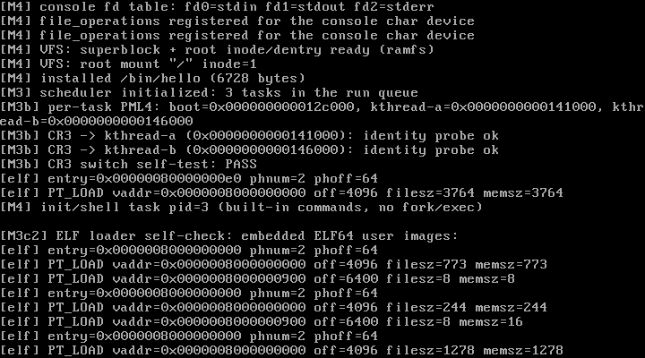

# Lantest OS

[](LICENSE)
[](#quick-start)
[-brightgreen.svg)](#status)

**[English](#lantest-os)** | [简体中文](#兰特斯特操作系统lantest-os)

An **independent x86_64 SMP kernel written from scratch**. The design is
inspired by Linux (monolithic kernel, VFS, process model, syscalls, scheduler),
but the project:

- contains **no Linux source code**;
- was **not developed on top of Linux**;
- does **not implement the Linux ABI** — syscall numbers, register conventions,
  error codes, kernel object layouts and the build system are original.



## Status

Current milestone: **M4-47d** — release gate met: **50/50** fresh-disk boots,
10/10 persistence, 5/5 exception, `-d int` 5/5, `-icount shift=7` 3/3, zero
warnings (see `docs/release-gate.md`). Formal **v0.1.0** release in progress.

Measured on QEMU 10.2.1 (`-cpu max -smp 4 -m 512M`), fresh 16 MiB disk:

| Check | Result |
| --- | --- |
| Build (`-Wall -Wextra`) | 0 warnings |
| `make test` × 10 | **7/10 green** — every green run: stress workers 3/3, apuser tasks on CPU1–3, shell pipelines, Lua, LFS persistence |
| `make test-persist` | PASS (boot_count 1 → 2 across reboots) |
| `make test-exception` | PASS |

Honest caveat: ~3/10 fresh-disk boots stall in a **localized AP bring-up timing
race** (fixed `ap_delay` handshake in `start_one_ap`; deterministic repro under
`qemu -d int`). Root cause and fix are documented in `docs/M4-*.md`.

## Quick start

Recommended location: the native Linux filesystem (e.g. `~/lantest` on WSL2).
Do **not** build under `/mnt/c` — cross-system I/O makes `make` several times
slower once the object count grows, and has wedged WSL before.

Dependencies (Debian/Ubuntu):

```bash
sudo apt install -y build-essential grub-pc-bin grub-common xorriso mtools qemu-system-x86 gdb
```

Build and run:

```bash
make                    # compile the kernel and pack lantest.iso
make run                # QEMU with a graphics window (WSL2 needs WSLg)
make run-nographic      # no display: serial on the terminal (Ctrl-A X to quit)
make test               # headless boot self-test (~60 serial markers)
make test-persist       # two boots, one disk: LFS boot_count 1 -> 2
make test-exception     # deliberate kernel #PF: exception handler + panic
```

Debugging:

```bash
make debug              # terminal 1: QEMU paused, gdbstub on :1234
make gdb                # terminal 2: GDB, hbreak at kernel_main, continue
make clean
```

`lantest.iso` also boots in VirtualBox / VMware (BIOS mode, 512 MB). **VirtualBox
7.2.16 is verified**: it boots fine **without any serial port configured** — the
kernel probes the 16550 UART (writes the scratch register and reads it back) and
automatically falls back to VGA-only output, so it never blocks on a missing
UART.

## Repository layout

```
lantest/
├── boot.S          # Multiboot2 header, 32→64-bit trampoline, early GDT/stack
├── kernel.c        # kernel_main: ordered init (GDT/TSS, IDT, PIC/PIT, PMM…)
├── linker.ld       # 1 MiB load address, segment layout
├── grub.cfg        # GRUB2 Multiboot2 config
├── Makefile        # build / ISO / QEMU run / debug / test suites
├── include/        # kernel headers (types/io/kprintf/… + x86_64/)
├── libk/           # kprintf, panic (no libc, no libgcc)
├── arch/x86_64/    # gdt, idt, irq, isr_asm.S, switch.S, paging, smp, lapic, tlb…
├── mm/             # pmm, kmalloc, elf loader, uaccess (copyin/out + fixup)
├── sched/          # scheduler: per-CPU queues, COW, VMA, deferred reap
├── fs/  syscall/   # VFS, ramfs, LantestFS, fd table; int 0x80 syscall table
├── drivers/        # uart, vga, console, pci, virtio_blk, keyboard (IRQ1)
├── user/           # libc, shell, ~20 test programs, Lua 5.4.7 port
├── docs/           # design.md + ~60 milestone reports + screenshots (Chinese)
└── .github/        # CI + Release workflows, issue/PR templates
```

## Documentation

`docs/design.md` is the master design document. Milestone reports (currently in
Chinese) live in `docs/M4-*.md`, `docs/M3*.md`, `docs/M5-*.md`:

- **Boot & core**: [M1](docs/M1-boot.md) · [M2](docs/M2-core.md)
- **Heap & scheduler**: [M3a](docs/M3-heap-sched.md) · [M3b-1 paging](docs/M3b-paging.md) · [M3b-2 Ring3/syscall](docs/M3b-ring3-syscall.md) · [M3c-1 lifecycle](docs/M3c-lifecycle.md) · [M3c-2 ELF](docs/M3c-elf.md) · [M3c-3 uaccess/SMAP](docs/M3c-uaccess.md)
- **Files, shell, IPC**: [M4-1 fd/console](docs/M4-fd-console.md) · [M4-2 VFS/ramfs](docs/M4-vfs-ramfs.md) · [M4-3 shell](docs/M4-shell.md) · [M4-4 fork/exec/unlink](docs/M4-fork-exec-unlink.md) · [M4-5 argv/envp](docs/M4-argv-envp.md) · [M4-6 keyboard](docs/M4-external-shell-keyboard.md) · [M4-7 line editor](docs/M4-shell-line-editor.md) · [M4-8 pipes](docs/M4-pipes.md) · [M4-9 external commands](docs/M4-external-commands.md) · [M4-10 SIGPIPE](docs/M4-signals-sigpipe.md) · [M4-11 multi-stage pipes](docs/M4-multistage-pipes.md) · [M4-12 pgid/Ctrl-C](docs/M4-pgid-ctrl-c.md) · [M4-13 job control](docs/M4-job-control.md)
- **Memory & paging**: [M4-14 COW/VMA](docs/M4-cow-vma.md) · [M4-15 demand paging](docs/M4-demand-paging.md) · [M4-16 SIGSEGV](docs/M4-sigsegv.md) · [M4-17 file-backed ELF](docs/M4-filebacked-elf-lazy.md) · [M4-18 page cache](docs/M4-page-cache.md) · [M4-19 munmap/mprotect](docs/M4-munmap-mprotect.md) · [M4-21 shared pages](docs/M4-shared-pagecache.md)
- **Storage**: [M5-1 virtio-blk](docs/M5-block.md) · [M5-2 LantestFS](docs/M5-lantestfs.md) · [M5-3b journaling](docs/M5-3b-journal.md)
- **Userland runtime**: [M4-20 malloc](docs/M4-malloc.md) · [M4-22 libc](docs/M4-libc.md) · [M4-23 FILE streams](docs/M4-stdio-file.md) · [M4-24 lseek/buffering](docs/M4-lseek-buffered-stdio.md) · [M4-25 write buffer](docs/M4-file-writebuffer.md) · [M4-26 Lua prereqs](docs/M4-lua-prereq.md) · [M4-27 SSE/FPU](docs/M4-sse-fpu.md) · [M4-28 Lua port](docs/M4-lua-port.md) · [M4-29 Lua stdlib](docs/M4-lua-stdlibs.md) · [M4-30 io/math REPL](docs/M4-fpu-io-repl.md) · [M4-31 multiline math](docs/M4-math-repl-multiline.md)
- **SMP & concurrency**: [M4-32 foundation](docs/M4-smp-foundation.md) · [M4-33 AP wakeup](docs/M4-ap-wakeup.md) · [M4-34 per-CPU/locks](docs/M4-percpu-locks.md) · [M4-35 lifecycle lock](docs/M4-task-lifecycle-lock.md) · [M4-37 TSS/IDT](docs/M4-percpu-tss-ap-idt.md) · [M4-38 AP timer](docs/M4-ap-timer-iret.md) · [M4-39 swapgs](docs/M4-swapgs.md) · [M4-40 AP smoke](docs/M4-ap-user-smoke.md) · [M4-41 AP scheduler](docs/M4-ap-scheduler.md) · [M4-42 multi-AP users](docs/M4-multi-ap-users.md) · [M4-43 active_cpus](docs/M4-active-cpus.md) · [M4-44 IPI wake](docs/M4-ipi-wake.md) · [M4-45 TLB/locks](docs/M4-final-concurrency.md) · [M4-46 hardening](docs/M4-concurrency-hardening.md) · [M4-47a ABBA](docs/M4-pcache-abba.md) · [M4-47b IPI/wait](docs/M4-47b.md)

## Boundary statement

1. **Code independence.** All kernel code is written by this project, guided by
   published OS theory and the x86/ACPI specs. No Linux source, headers or
   internal APIs.
2. **Custom ABI.** Syscall numbers, register conventions, error codes and
   object layouts are original. A Linux compatibility layer, if ever built,
   would be an optional userland module.
3. **Single-core first, SMP later** (done): boot and paging started
   single-core; SMP landed across M4-32…M4-47b and is verified on 4 vCPUs in
   QEMU.

## Milestones

| Group | Content | Status |
| --- | --- | --- |
| M1 | GRUB/Multiboot2 → 64-bit C kernel; UART + VGA + kprintf; QEMU/GDB | ✅ |
| M2 | GDT/TSS, 256-gate IDT, exceptions/IRQs, PIC/PIT 100 Hz, physical bitmap allocator | ✅ |
| M3 | kmalloc, tasks, `switch_to`, RR scheduling, per-task PML4, Ring 3 + `int 0x80`, fork/exec/wait, ELF64, copyin/copyout + SMAP | ✅ |
| M4 (files) | fd table, VFS, ramfs, shell + line editor, fork/exec/unlink, pipes + dup2, job control, multi-stage pipelines | ✅ |
| M4 (memory) | COW fork, VMA, demand paging, SIGSEGV, file-backed lazy ELF, page cache, munmap/mprotect, shared mmap + msync, userland malloc/libc/stdio | ✅ |
| M4 (runtime) | SSE/FPU context, Lua 5.4.7 port with io/os/math + REPL | ✅ |
| M4 (SMP) | MADT + x2APIC, SIPI trampoline, per-CPU current/GS/TSS/IDT, AP timers, per-CPU queues, 3-AP concurrent users, TLB shootdown, IPI wake (ICR pending fix), ABBA + lost-wakeup fixes, deferred reap | ✅ |
| M5 | PCI + virtio-blk, LantestFS with journaling, persistence across reboots | ✅ |
| v0.0.38b | First public snapshot (squashed history, Apache-2.0, CI/Release workflows) | ✅ |
| M4-47c | AP bring-up race: param-ack/stage handshake with bounded waits | ⏳ |

## Repository

- GitHub: <https://github.com/LantestOS/LantestOS-kernel>
- Clone: `git clone https://github.com/LantestOS/LantestOS-kernel.git`
- Keep `make test` green on a **fresh** disk image before sending patches.

## Contact & contributing

Maintainer: LantestOS — **nanjuong@outlook.com**

CI builds and runs the boot / persistence / exception self-tests on every
push (GitHub Actions). Want to help? Read [CONTRIBUTING.md](CONTRIBUTING.md) first.

## License

Apache License 2.0 — see [LICENSE](LICENSE) and [NOTICE](NOTICE).
Contributions are accepted under the same terms; see
[CONTRIBUTORS.md](CONTRIBUTORS.md).

---

# 兰特斯特操作系统（Lantest OS）


[](LICENSE)
[](#快速开始)
[](#路线图与状态)

一个**从零独立实现**的 x86_64 宏内核（SMP，QEMU `-smp 4` 验证）。设计思想参考 Linux（宏内核、VFS、进程模型、系统调用、调度器），但：

- 不复制 Linux 源码；
- 不基于 Linux 开发；
- 不依赖 Linux ABI（系统调用号、对象布局、构建系统全部自定义）。

当前状态：**M4-47d 完成**（TLB 活锁 + 串口丢字 + 堆护栏；发布门槛 50/50 达成，v0.1.0 进行中）（QEMU `-smp 4`）—— 补上 per-CPU GS 的 swapgs：KERNEL_GS_BASE=0，user_enter 前 swapgs，isr_common 按栈上 CS 在入口/出口 swapgs。BSP 用户任务、Lua、fork、shell 全部回归 PASS。AP 已有 per-CPU ready queue；BSP 把三个 apuser 分别挂到 CPU1/2/3，三个 AP 的 LVT timer 各自触发本地 `schedule()`，全部进入 Ring3 并完成 `sys_exit(42)`（cpu=1/2/3 status=42），BSP reaper 回收。新增每任务 `active_cpus`：AP 进入用户任务 inc、切走/exit dec，`task_reap` 在释放页表前等待归零。3 AP 并发 apuser 仍 PASS。补齐多核并发关键锁：kmalloc/kfree 堆锁、virtio-blk 请求锁、vfs_open(O_CREAT)/release/数据读写大锁（并修复 pcache↔vfs 的 AB-BA 死锁）；task_wakeup 统一唤醒（含 AP 任务重回本地队列）；deferred reap 队列让 active_cpus 未清零的 AP 任务稍后回收。3 个 stress worker 各 fork 3 子进程（写内存 + 建文件写）在 CPU1/2/3 并发 PASS，全新磁盘双启动 boot_count 1→2 LFS 挂载正常，零 PANIC。AP idle 暂为轮询 schedule（IPI 唤醒待修）。M4-47a：以 fresh-disk 复测发现 M4-46 绿灯有水分（复用脏盘），GDB 定位并拆除 page_cache 驱逐与 syscall 写路径的 pcache_lock↔vfs_lock ABBA 死锁（驱逐改为锁外 file_close），fresh-disk make test 从 ~1/3 提升到 **8/10**；残留晚期冻结 2/10 与 IPI 不投递（ACK TIMEOUT）为 M4-47b 目标。


---

## 快速开始

> 项目位于 **WSL2 家目录 `~/lantest`**（不要在 `/mnt/c` 下构建：M2 之后文件变多，跨系统 I/O 会明显拖慢 make）。

环境：WSL2 Ubuntu（或任意 Linux 桌面）。依赖：

```bash
sudo apt install -y build-essential grub-pc-bin grub-common xorriso mtools qemu-system-x86 gdb
```

构建与运行：

```bash
cd ~/lantest
make                    # 编译内核并打包成 lantest.iso
make run                # QEMU 图形窗口运行（WSL2 需要 WSLg）
make run-nographic      # 无图形环境：串口输出到终端（Ctrl-A 再 X 退出）
make test               # 无头启动自检：约 60 个串口 marker（VFS/进程/SMP/用户程序）
make test-persist       # 双启动持久化：LFS boot_count 1 → 2
make test-exception     # 故意触发内核 #PF，验证异常处理器与 panic
```

调试：

```bash
make debug              # 终端 1：QEMU 暂停，GDB stub 监听 :1234
make gdb                # 终端 2：连接 GDB，在 kernel_main 下硬件断点并继续
```

清理：

```bash
make clean
```

> 也可以直接用 VirtualBox / VMware 以 BIOS 方式打开 `lantest.iso`。
> **VirtualBox 7.2.16 已实测**：512 MB / BIOS / 不配置串口也能正常启动并持续输出。
> （含义：内核启动时会探测 16550 UART——写入 scratch 寄存器再读回验证——
> 探测不到就自动降级为纯 VGA 文本输出，因此没有串口的虚拟机同样可用，不会卡死。）

---

## 目录结构

```
lantest/
├── boot.S          # Multiboot2 头 + 32→64 位长模式跳板 + 早期 GDT/栈
├── kernel.c        # kernel_main：按顺序初始化 GDT/TSS、IDT、PIC/PIT、PMM
├── linker.ld       # 1 MiB 加载地址、_kernel_start/_kernel_end、段布局
├── grub.cfg        # GRUB2 引导配置（Multiboot2，输出仅 VGA）
├── Makefile        # 编译 / ISO / QEMU run / debug / test / test-exception
├── include/        # 自研内核头文件（types/io/kprintf/... + x86_64/）
├── libk/           # kprintf、panic（无 libc / 无 libgcc）
├── drivers/        # uart、vga、console、pci、virtio_blk、keyboard（IRQ1）
├── fs/             # file.c、vfs.c（后端抽象）、ramfs.c、lantestfs.c（持久化）
├── arch/x86_64/    # gdt.c、idt.c、isr_asm.S、irq.c、switch.S、paging.c、usermode.S、uaccess_asm.S
├── sched/          # scheduler.c（task、环形 RR、PIT 抢占）
├── mm/             # multiboot2.c、pmm.c、kmalloc.c、elf.c、uaccess.c（copyin/out+fixup）
├── syscall/        # syscall.c（int 0x80：write/exit/getpid）
├── user/           # parent.c、child.c、filetest.c、hello.c、unlinktest.c、init.c、shell.c、userlib.h、user.ld
├── docs/
│   ├── design.md   # 总体设计：边界原则、架构、子系统、ABI 草案、路线图
│   ├── M1-boot.md  # M1 里程碑：引导、长模式、串口/VGA、GDB
│   ├── M2-core.md  # M2 里程碑：TSS/IDT/异常/PIC/PIT/PMM 与实测记录
│   ├── M3-heap-sched.md # M3a 里程碑：kmalloc/task/switch_to/RR 调度
│   ├── M3b-paging.md # M3b-1：每任务 PML4 + CR3 切换实测
│   ├── M3b-ring3-syscall.md # M3b-2：Ring 3 + int 0x80 实测
│   ├── M3c-lifecycle.md # M3c-1：exit/wait/僵尸回收实测
│   ├── M3c-elf.md # M3c-2：ELF64 加载器 + C 用户程序实测
│   ├── M3c-uaccess.md # M3c-3：copyin/copyout + fixup + SMAP 实测
│   ├── M4-fd-console.md # M4-1：fd 表 + console + write(fd,...) 实测
│   ├── M4-vfs-ramfs.md # M4-2：VFS + ramfs 文件读写实测
│   ├── M4-shell.md # M4-3：串口输入 + mkdir + 目录 read + shell 实测
│   ├── M4-fork-exec-unlink.md # M4-4：fork/exec/unlink 实测
│   ├── M5-block.md # M5-1：PCI + virtio-blk + 持久化 boot_count 实测
│   ├── M5-lantestfs.md # M5-2：LantestFS 持久化文件系统实测
│   ├── M4-argv-envp.md # M4-5：argv/envp + 持久化 /bin/hello 实测
│   ├── M4-external-shell-keyboard.md # M4-6：/bin/sh + init 重启 + 键盘 IRQ 实测
│   ├── M4-shell-line-editor.md # M4-7：行编辑 + 历史 + Tab 补全实测
│   ├── M4-pipes.md # M4-8：pipe/dup2 + Shell 管道 + 间接块实测
│   ├── M4-external-commands.md # M4-9：/bin/ls、cat、echo 独立 ELF 实测
│   ├── M4-signals-sigpipe.md # M4-10：SIGPIPE + /bin/head 实测
│   ├── M4-multistage-pipes.md # M4-11：3/4 段管道与 fd 关闭实测
│   ├── M4-pgid-ctrl-c.md # M4-12：PGID/Ctrl-C/后台 & 实测
│   ├── M4-job-control.md # M4-13：SIGTSTP/SIGCONT、jobs/fg/bg 实测
│   ├── M4-cow-vma.md # M4-14：COW fork + 页引用计数 + VMA/mmap 实测
│   ├── M4-demand-paging.md # M4-15：VMA 按需分页实测
│   ├── M4-sigsegv.md # M4-16：用户 #PF → SIGSEGV 实测
│   ├── M4-filebacked-elf-lazy.md # M4-17：file-backed VMA + ELF 按需加载实测
│   ├── M4-page-cache.md # M4-18：Page Cache 代码页共享命中实测
│   ├── M4-munmap-mprotect.md # M4-19：munmap/mprotect 与 muntest 实测
│   ├── M4-malloc.md # M4-20：用户态 malloc 与 malloctest 实测
│   ├── M5-3b-journal.md # M5-3b：Redo Log/backup SB 与故障注入实测
│   ├── M4-shared-pagecache.md # M4-21：MAP_SHARED/msync/Page Cache LRU 实测
│   ├── M4-libc.md # M4-22：用户态 printf/snprintf/字符串/内存函数实测
│   ├── M4-stdio-file.md # M4-23：FILE 流 + printf 重构实测
│   ├── M4-lseek-buffered-stdio.md # M4-24：lseek/读缓冲/追加模式实测
│   ├── M4-file-writebuffer.md # M4-25：FILE 写缓冲/fflush 实测
│   ├── M4-lua-prereq.md # M4-26：setjmp/longjmp、errno、time、fflush(NULL)、16 页栈
│   ├── M4-sse-fpu.md # M4-27：SSE/FPU 启用与 floattest
│   ├── M4-lua-port.md # M4-28：Lua 5.4.7 移植与 Hello 实测
│   ├── M4-lua-stdlibs.md # M4-29：Lua table/string/utf8 实测
│   ├── M4-fpu-io-repl.md # M4-30：FPU 上下文、Lua io/os/math、REPL 实测
│   ├── M4-math-repl-multiline.md # M4-31：math 真实现与 REPL 多行
│   ├── M4-smp-foundation.md # M4-32：MADT 4 CPU、x2APIC、spinlock 实测
│   ├── M4-ap-wakeup.md # M4-33：AP SIPI trampoline + 跨核自旋锁实测
│   ├── M4-percpu-locks.md # M4-34：per-CPU current、kprintf/schedule 锁、AP idle
│   ├── M4-task-lifecycle-lock.md # M4-35：任务链表锁；AP 用户调度仍关闭
│   ├── M4-percpu-tss-ap-idt.md # M4-37：per-CPU TSS、AP IDT、0x30 异常实测
│   ├── M4-ap-timer-iret.md # M4-38：AP CS 重载、0x30 返回、LVT timer
│   ├── M4-swapgs.md # M4-39：per-CPU GS 与 swapgs 修正
│   ├── M4-ap-user-smoke.md # M4-40：AP Ring3 sys_exit(42) 实测
│   ├── M4-ap-scheduler.md # M4-41：per-CPU queue + AP timer 本地调度
│   ├── M4-multi-ap-users.md # M4-42：CPU1/2/3 并发用户任务实测
│   ├── M4-active-cpus.md # M4-43：active_cpus + reap 等待
│   ├── M4-ipi-wake.md # M4-44：IPI 0xFE 队列唤醒
│   ├── M4-final-concurrency.md # M4-45：TLB shootdown 与并发锁
│   ├── M4-concurrency-hardening.md # M4-46：堆/VFS/virtio 锁、deferred reap、多 AP 压测
│   ├── M4-pcache-abba.md # M4-47a：pcache↔vfs ABBA 修复，fresh 8/10
│   ├── M4-47b.md # M4-47b：ICR 投递排空 + wait 唤醒窗口原子化，fresh 7/10
│   ├── m1-vga.png  # M1 实测 VGA 截图
│   ├── m2-vga.png  # M2 实测 VGA 截图（QEMU）
│   ├── m2-vbox.png # M2 实测截图（VirtualBox 7.2.16）
│   ├── m3-vbox.png # M3a 实测截图（VirtualBox 7.2.16）
│   ├── m3b-vbox.png # M3b-1 实测截图（VirtualBox 7.2.16）
│   ├── m3b2-vbox.png # M3b-2 实测截图（Ring 3 + syscall）
│   ├── m3c1-vbox.png # M3c-1 实测截图（生命周期）
│   ├── m3c2-vbox.png # M3c-2 实测截图（C ELF）
│   ├── m3c3-vbox.png # M3c-3 实测截图（恶意指针被拒绝）
│   ├── m4a-vbox.png # M4-1 实测截图（fd table + console）
│   ├── m4b-vbox.png # M4-2 实测截图（ramfs 文件读写）
│   ├── m4c-vbox.png # M4-3 实测截图（shell 启动）
│   ├── m4d-vbox.png # M4-4 实测截图（fork + exec + delete-on-close）
│   └── m5a-qemu.png # M5-1 QEMU 启动截图（virtio 日志见串口）
└── .gitignore / .gitattributes
```

---

## 文档

- [设计文档 docs/design.md](docs/design.md)
- [M1 引导里程碑 docs/M1-boot.md](docs/M1-boot.md)
- [M2 中断与内存里程碑 docs/M2-core.md](docs/M2-core.md)
- [M3a 内核堆与调度 docs/M3-heap-sched.md](docs/M3-heap-sched.md)
- [M3b-1 每任务 PML4 与 CR3 切换 docs/M3b-paging.md](docs/M3b-paging.md)
- [M3b-2 Ring 3 与 int 0x80 syscall docs/M3b-ring3-syscall.md](docs/M3b-ring3-syscall.md)
- [M3c-1 进程生命周期 docs/M3c-lifecycle.md](docs/M3c-lifecycle.md)
- [M3c-2 ELF64 加载器 docs/M3c-elf.md](docs/M3c-elf.md)
- [M3c-3 用户内存安全 docs/M3c-uaccess.md](docs/M3c-uaccess.md)
- [M4-1 file 对象与 fd 表 docs/M4-fd-console.md](docs/M4-fd-console.md)
- [M4-2 VFS 与 ramfs docs/M4-vfs-ramfs.md](docs/M4-vfs-ramfs.md)
- [M4-3 shell 与目录 docs/M4-shell.md](docs/M4-shell.md)
- [M4-4 fork / exec / unlink docs/M4-fork-exec-unlink.md](docs/M4-fork-exec-unlink.md)
- [M5-1 virtio-blk docs/M5-block.md](docs/M5-block.md)
- [M5-2 LantestFS docs/M5-lantestfs.md](docs/M5-lantestfs.md)
- [M5-3b Journaling docs/M5-3b-journal.md](docs/M5-3b-journal.md)
- [M4-21 共享页/脏页回写 docs/M4-shared-pagecache.md](docs/M4-shared-pagecache.md)
- [M4-22 用户态 libc docs/M4-libc.md](docs/M4-libc.md)
- [M4-23 FILE 流 docs/M4-stdio-file.md](docs/M4-stdio-file.md)
- [M4-24 lseek/缓冲 stdio docs/M4-lseek-buffered-stdio.md](docs/M4-lseek-buffered-stdio.md)
- [M4-25 FILE 写缓冲 docs/M4-file-writebuffer.md](docs/M4-file-writebuffer.md)
- [M4-26 Lua 前置 docs/M4-lua-prereq.md](docs/M4-lua-prereq.md)
- [M4-27 SSE/FPU docs/M4-sse-fpu.md](docs/M4-sse-fpu.md)
- [M4-28 Lua 移植 docs/M4-lua-port.md](docs/M4-lua-port.md)
- [M4-29 Lua 标准库 docs/M4-lua-stdlibs.md](docs/M4-lua-stdlibs.md)
- [M4-30 FPU/io/os/REPL docs/M4-fpu-io-repl.md](docs/M4-fpu-io-repl.md)
- [M4-31 math/REPL 多行 docs/M4-math-repl-multiline.md](docs/M4-math-repl-multiline.md)
- [M4-32 SMP 地基 docs/M4-smp-foundation.md](docs/M4-smp-foundation.md)
- [M4-33 AP 唤醒 docs/M4-ap-wakeup.md](docs/M4-ap-wakeup.md)
- [M4-34 per-CPU/锁 docs/M4-percpu-locks.md](docs/M4-percpu-locks.md)
- [M4-35 任务生命周期锁 docs/M4-task-lifecycle-lock.md](docs/M4-task-lifecycle-lock.md)
- [M4-37 Per-CPU TSS/AP IDT docs/M4-percpu-tss-ap-idt.md](docs/M4-percpu-tss-ap-idt.md)
- [M4-38 AP timer/iret docs/M4-ap-timer-iret.md](docs/M4-ap-timer-iret.md)
- [M4-39 swapgs docs/M4-swapgs.md](docs/M4-swapgs.md)
- [M4-40 AP 用户 smoke docs/M4-ap-user-smoke.md](docs/M4-ap-user-smoke.md)
- [M4-41 AP 本地调度 docs/M4-ap-scheduler.md](docs/M4-ap-scheduler.md)
- [M4-42 三 AP 并发 docs/M4-multi-ap-users.md](docs/M4-multi-ap-users.md)
- [M4-43 active_cpus docs/M4-active-cpus.md](docs/M4-active-cpus.md)
- [M4-44 IPI 唤醒 docs/M4-ipi-wake.md](docs/M4-ipi-wake.md)
- [M4-45 TLB/锁 docs/M4-final-concurrency.md](docs/M4-final-concurrency.md)
- [M4-46 并发硬化 docs/M4-concurrency-hardening.md](docs/M4-concurrency-hardening.md)
- [M4-47a pcache ABBA docs/M4-pcache-abba.md](docs/M4-pcache-abba.md)
- [M4-47b IPI/wait docs/M4-47b.md](docs/M4-47b.md)
- [M4-5 argv/envp 与持久化 /bin/hello docs/M4-argv-envp.md](docs/M4-argv-envp.md)
- [M4-6 外部 Shell 与键盘 docs/M4-external-shell-keyboard.md](docs/M4-external-shell-keyboard.md)
- [M4-7 Shell 行编辑器 docs/M4-shell-line-editor.md](docs/M4-shell-line-editor.md)
- [M4-8 管道与 dup2 docs/M4-pipes.md](docs/M4-pipes.md)
- [M4-9 外部命令 docs/M4-external-commands.md](docs/M4-external-commands.md)
- [M4-10 SIGPIPE docs/M4-signals-sigpipe.md](docs/M4-signals-sigpipe.md)
- [M4-11 多级管道 docs/M4-multistage-pipes.md](docs/M4-multistage-pipes.md)
- [M4-12 PGID/Ctrl-C/后台 docs/M4-pgid-ctrl-c.md](docs/M4-pgid-ctrl-c.md)
- [M4-13 作业控制 docs/M4-job-control.md](docs/M4-job-control.md)
- [M4-14 COW/VMA docs/M4-cow-vma.md](docs/M4-cow-vma.md)
- [M4-15 按需分页 docs/M4-demand-paging.md](docs/M4-demand-paging.md)
- [M4-16 SIGSEGV docs/M4-sigsegv.md](docs/M4-sigsegv.md)
- [M4-17 File-backed/ELF lazy docs/M4-filebacked-elf-lazy.md](docs/M4-filebacked-elf-lazy.md)
- [M4-18 Page Cache docs/M4-page-cache.md](docs/M4-page-cache.md)
- [M4-19 munmap/mprotect docs/M4-munmap-mprotect.md](docs/M4-munmap-mprotect.md)
- [M4-20 用户态 malloc docs/M4-malloc.md](docs/M4-malloc.md)

---

## 边界声明（简版）

1. **代码独立**：内核代码全部自行编写，参考公开 OS 原理与体系结构规范，不复制 Linux 源码、不使用 Linux 头文件或内核 API。
2. **ABI 自定义**：系统调用号、寄存器约定、错误码、内核对象布局自行定义；若未来做 Linux 兼容层，只作为可选用户态模块。
3. **先单核后 SMP（已完成）**：启动与分页从单核起步；SMP 已在 M4-32…M4-47b 落地，QEMU 4 vCPU 验证。

---

## 里程碑

| 里程碑 | 内容 | 状态 |
| --- | --- | --- |
| M1 | GRUB/Multiboot2 → 64 位 C 内核；UART + VGA + kprintf；QEMU/GDB | ✅ |
| M2 | GDT/TSS、256 门 IDT、异常/IRQ、PIC/PIT 100 Hz、Multiboot2 内存图、物理页 Bitmap 分配器 | ✅ |
| M3a | 连续页分配、kmalloc/kfree 内核堆、task/switch_to、环形 RR + PIT 抢占 | ✅ |
| M3b-1 | 每任务 PML4、CR3 切换、per-task TSS.RSP0、CR3 自检 | ✅ |
| M3b-2 | Ring 3（iretq）、用户页表/栈（U/S 位）、int 0x80 syscall、用户程序 | ✅ |
| M3c-1 | 进程状态机、exit→ZOMBIE、wait 阻塞/回收、孤儿回收、页表释放 | ✅ |
| M3c-2 | ELF64 加载器（PT_LOAD 按页映射、共享页、.bss 清零、e_entry）、C 用户程序 | ✅ |
| M3c-3 | copyin/copyout、异常表 fixup、SMAP、AC/DF 防护、恶意指针测试 | ✅ |
| M4-1 | file/file_operations、每任务 fd 表、console 字符设备、write(fd,...) | ✅ |
| M4-2 | VFS 骨架、绝对路径解析、ramfs 4 KiB 块链、open/read/close | ✅ |
| M4-3 | COM1 输入、mkdir、目录 read/dirent、O_TRUNC、init/shell | ✅ |
| M4-4 | 深拷贝 fork、execve、unlink + delete-on-close、shell run/rm | ✅ |
| M5-1 | PCI 枚举、legacy virtio-blk、virtqueue/DMA、持久化 boot_count | ✅ |
| M5-2 | LantestFS：超级块/inode/位图/目录、buffer cache、format/mount、持久化文件 | ✅ |
| M4-5 | argv/envp、naked `_start`、Shell run 参数、持久化 `/bin/hello` | ✅ |
| M4-6 | 外部 `/bin/sh`、init fork/exec + 重启、PS/2 键盘 IRQ1 | ✅ |
| M4-7 | 用户态行编辑器、命令历史 ↑/↓、Tab 命令/路径补全 | ✅ |
| M4-8 | pipe/dup2、阻塞 IPC、Shell `cmd1 \| cmd2`、LFS 一级间接块 | ✅ |
| M4-9 | `/bin/ls` `/bin/cat` `/bin/echo` 外部 ELF、Shell fork/execve、重定向 | ✅ |
| M4-10 | 最小信号、SIGPIPE 默认终止、`/bin/head`、`cat \| head` 实测 | ✅ |
| M4-11 | 最多 8 段管道、fd 全关闭、3/4 段实测 | ✅ |
| M4-12 | PGID、setpgid/set_fg/detach、Ctrl-C→SIGINT、后台 `&` | ✅ |
| M4-13 | TASK_STOPPED、SIGTSTP/CONT、waitpid、jobs/fg/bg | ✅ |
| M4-14 | 页引用计数、COW fork、#PF 复制、VMA/mmap | ✅ |
| M4-15 | mmap 只建 VMA、#PF demand、清零页、COW/demand 同入口 | ✅ |
| M4-16 | 用户 #PF→SIGSEGV、退出码 139、内核不 panic | ✅ |
| M4-17 | file-backed VMA/mmap_file、ELF PT_LOAD→VMA、BSS/代码权限 | ✅ |
| M4-18 | `(inode,page_index)` Page Cache、只读代码页共享、跨 exec 命中 | ✅ |
| M4-19 | VMA 拆分/删除/权限、munmap/mprotect、PTE 清空/COW | ✅ |
| M4-20 | 用户态 malloc/free/calloc/realloc、64 KiB chunk、大块 mmap/munmap | ✅ |
| M5-3b | LantestFS v2 Redo Log、commit/replay、备份超级块 | ✅ |
| M4-21 | MAP_SHARED、PTE_SHARED fork、msync 写回、Page Cache LRU | ✅ |
| M4-22 | 用户态 printf/snprintf、字符串/内存、atoi、puts | ✅ |
| M4-23 | FILE 流、stdin/stdout/stderr、Shell/ls/cat/echo/head printf 重构 | ✅ |
| M4-24 | SYS_LSEEK、FILE 512B 读缓冲、fseek/ftell、a/a+ 追加 | ✅ |
| M4-25 | FILE 512B 写缓冲、fflush、fclose/fseek/ftell 自动 flush | ✅ |
| M4-26 | 16 页栈、setjmp/longjmp、errno、sys_time、fflush(NULL) | ✅ |
| M4-27 | CR4/CR0 SSE/FPU 启用、fninit、USER_FLOAT_CFLAGS、floattest | ✅ |
| M4-28 | Lua 5.4.7 core+base、multi-TU libc、/bin/lua、Hello 实测 | ✅ |
| M4-29 | Lua table/string/utf8 库、脚本路径、UTF-8 输出 | ✅ |
| M4-30 | FXSAVE/FXRSTOR、Lua io/os/math、REPL、Lua 写文件 | ✅ |
| M4-31 | x87/SSE/Taylor math、精确整数 pow、REPL 多行 | ✅ |
| M4-32 | MADT 4 CPU、x2APIC、spinlock、PMM 加锁（AP 未启动） | ✅ |
| M4-33 | 0x6000 AP trampoline、INIT/SIPI、AP online=3、跨核 spinlock | ✅ |
| M4-34 | GS per-CPU current、kprintf 锁、run_queue_lock、AP idle | ✅ |
| M4-35 | task_alloc/reap/count 加锁；AP 用户调度未启用 | 部分 ✅ |
| M4-37 | 8 个 per-CPU TSS、AP gdt/ltr、AP IDT、0x30 异常 | ✅ |
| M4-38 | AP CS 重载、0x30 返回、AP LVT timer 0x31、EOI | ✅ |
| M4-39 | KERNEL_GS_BASE、user_enter/ISR swapgs；AP 用户任务回滚 | 基础 ✅ |
| M4-40 | AP 原子认领 user-apuser，Ring3 sys_exit(42) | ✅ |
| M4-41 | per-CPU queue + AP timer 自动调度 user-apuser | ✅ |
| M4-42 | CPU1/2/3 各自本地队列并发执行 apuser status=42 | ✅ |
| M4-43 | active_cpus + reap 等待 UAF 防护 | ✅ |
| M4-44 | IPI 0xFE 空队列立即唤醒 AP | ✅ |
| M4-45 | TLB shootdown + page_cache/pipe/VFS 锁 | ✅ |
| M4-46 | kmalloc/virtio/VFS 锁、deferred reap、3×3 stress 并发 PASS | ✅ |
| M4-47a | pcache↔vfs ABBA 修复；fresh-disk 8/10（残留晚期冻结 2/10） | ✅ |
| M4-47b | x2APIC ICR 排空修复 IPI 投递、wait 唤醒窗口原子化；fresh 7/10（残留冻结同签名，M4-47c） | ✅ |
| M6 | SMP、网络、图形等 | 远期 |


## 代码仓库

- GitHub: <https://github.com/LantestOS/LantestOS-kernel>
- 克隆：`git clone https://github.com/LantestOS/LantestOS-kernel.git`
- 提交补丁前请先 `make test`（全新磁盘启动自检）保持绿灯。

## 联系方式与贡献

维护者：LantestOS — **nanjuong@outlook.com**

每次推送都会在 GitHub Actions 上运行构建 + 启动/持久化/异常自检。
欢迎贡献，请先阅读 [CONTRIBUTING.md](CONTRIBUTING.md)（英文）。

## 版本与变更

- 首个发布版本：**v0.0.38b**（2026-10-31）
- 变更记录：[CHANGELOG.md](CHANGELOG.md)

## 许可证

本项目使用 **Apache License 2.0**（见 [LICENSE](LICENSE) 与 [NOTICE](NOTICE)）。
提交补丁即视为同意按 Apache-2.0 授权；贡献者名单见 [CONTRIBUTORS.md](CONTRIBUTORS.md)。

