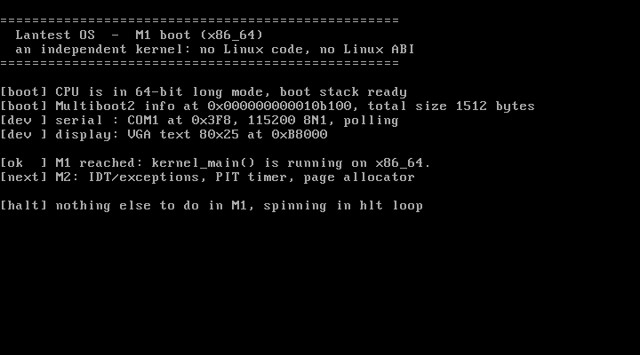

# M1 — Boot to 64-bit kernel（引导里程碑）

> 状态：**已完成并通过实测**  
> 日期：2026-10-27  
> 关联文档：[design.md](./design.md) · [M2-core.md](./M2-core.md)
>
> 注（M2 起）：项目已迁移到 WSL2 家目录 `~/lantest`；`grub.cfg` 不再把 GRUB 输出镜像到 COM1，以保证无串口环境（VirtualBox）兼容，详见 M2 文档。

---

## 1. 里程碑定义与范围

**目标**：从加电开始，经 GRUB/Multiboot2 引导，把 CPU 从 32 位保护模式带入 x86_64 长模式，并执行由 C 编写的 `kernel_main()`；同时具备最基本的输出能力（串口 + VGA）与可复现的构建/运行/调试流程。

**范围内（In Scope）**

- Multiboot2 引导头 + GRUB ISO 镜像；
- 32 位 → 64 位长模式跳板（页表、PAE、EFER.LME、GDT、far jump）；
- 启动栈与 C 入口传参；
- 16550 UART 轮询驱动（COM1，115200 8N1）；
- VGA 文本模式控制台（80×25，含滚动与光标）；
- `kprintf`（同时输出到串口与 VGA）；
- `make` / `make run` / `make run-nographic` / `make debug` / `make gdb` / `make test`；
- 本里程碑文档。

**范围外（Out of Scope，留给后续）**

- IDT、异常处理、panic 现场保存；
- PIT/APIC/PIC、中断驱动的 I/O；
- 物理内存分配器、内核堆；
- 用户态、系统调用、调度器；
- SMP、UEFI、磁盘/网络驱动。

---

## 2. 交付物

| 文件 | 作用 |
| --- | --- |
| `boot.S` | Multiboot2 头、32 位入口、长模式跳板、GDT、栈 |
| `kernel.c` | UART 驱动、VGA 控制台、`kprintf`、`kernel_main` |
| `linker.ld` | 1 MiB 加载地址、段布局、Multiboot2 头保活 |
| `grub.cfg` | GRUB2 菜单项（`multiboot2`）；M2 起 GRUB 输出仅走 VGA |
| `Makefile` | 编译、ISO 打包、QEMU 运行、GDB 调试、自动冒烟测试 |
| `docs/design.md` | 设计文档 |
| `docs/M1-boot.md` | 本文档 |
| `docs/m1-vga.png` | QEMU VGA 实测截图 |

构建产物：`kernel.elf`（26,840 字节）、`lantest.iso`（约 5.3 MiB，2712 个 ISO 扇区）。

---

## 3. 启动流程

```
[1] 加电 / QEMU 启动
      └─ SeaBIOS 1.17.0 初始化，读取 ISO 的 El Torito 引导记录
[2] GRUB2 (BIOS 模式)
      └─ 加载 /boot/grub/grub.cfg
      └─ multiboot2 /boot/kernel.elf
          · 校验 Multiboot2 头（magic / checksum）
          · 将 ELF 的 PT_LOAD 段加载到 1 MiB
          · 进入 32 位保护模式（A20 开启、分页关闭、中断关闭）
          · EAX = 0x36D76289（magic），EBX = Multiboot2 info 指针
[3] boot.S::_start（32 位）
      └─ cli；保存 EAX/EBX
      └─ 主动清零页表区（不依赖 GRUB 清 .bss）
      └─ CPUID 检查 long mode（80000001H:EDX[29]）
      └─ 建立 4 级页表：PML4 → PDPT → PD（512 × 2 MiB = 1 GiB 恒等映射）
      └─ CR4.PAE=1；IA32_EFER.LME=1；CR3=PML4；CR0.PG=1
      └─ lgdt 加载 64 位 GDT；ljmp $0x08 进入 64 位代码
[4] boot.S::long_mode_entry（64 位）
      └─ 设置数据段选择子 0x10
      └─ RSP = stack_top（16 KiB 启动栈）
      └─ kernel_main(mb2_info, mb2_magic)
[5] kernel.c::kernel_main（64 位 C）
      └─ serial_init() + vga_clear()
      └─ 校验 Multiboot2 magic，读取 info 结构 total_size
      └─ kprintf 输出 M1 横幅与检查结果
      └─ cli; hlt 死循环（M1 到此为止）
```

---

## 4. 关键实现细节

### 4.1 Multiboot2 头

按 Multiboot2 规范放在**文件前 32 KiB 内、8 字节对齐**的独立段 `.multiboot2` 中，由链接脚本 `KEEP` 保活：

```asm
.long 0xE85250D6                     /* magic */
.long 0                              /* architecture = i386 */
.long mb2_header_end - mb2_header    /* header length */
.long -(0xE85250D6 + 0 + (mb2_header_end - mb2_header))  /* checksum */
```

校验字段保证四项之和为 0；末尾带 `end tag`。可用 `grub-file --is-x86-multiboot2 kernel.elf` 验证（返回 0）。

### 4.2 32 位 → 64 位长模式跳板

Multiboot2 **只保证进入 32 位保护模式**，不能直接执行 64 位指令。跳板步骤：

1. `cpuid` 检查 `0x80000001` 与 `EDX[29]`（LM）；
2. 清零 3 个页表页（PML4/PDPT/PD），避免依赖 `.bss` 已被清零；
3. `PML4[0] → PDPT`，`PDPT[0] → PD`；
4. PD 的 512 项写成 `i * 2 MiB | 0x83`（present + writable + PS），得到 1 GiB 恒等映射；
5. `CR4.PAE = 1`；
6. `IA32_EFER.LME = 1`（MSR `0xC0000080`）；
7. `CR3 = PML4`；`CR0.PG = 1`；
8. `lgdt` 加载 GDT，`ljmp $0x08, $long_mode_entry` 完成模式切换。

### 4.3 GDT

M1 只需要三个描述符：

| 选择子 | 描述 |
| --- | --- |
| `0x00` | null |
| `0x08` | 64 位内核代码，DPL0，`0x00AF9A000000FFFF` |
| `0x10` | 内核数据，DPL0，`0x00AF92000000FFFF` |

GDT 在 32 位模式下加载，因此描述符表基址按 32 位存储（内核位于低 4 GiB 内）。

### 4.4 链接脚本与加载地址

- 起始地址 `. = 1M`，符合 Multiboot2 在 x86 上的常规加载约定；
- `.multiboot2` 作为第一个段 → 文件偏移 `0x1000`，满足"前 32 KiB"约束；
- `.text`、`.rodata`、`.bss` 均按 4 KiB 对齐；
- 丢弃 `.comment`、`.eh_frame`、`.note.*` 等运行时不需要的段；
- `_kernel_end` 预留给 M2 的物理内存分配器。

### 4.5 UART + VGA + kprintf

- **UART**：COM1（`0x3F8`），115200 8N1，轮询 LSR bit5（THR empty），M1 不用中断；
- **VGA**：`0xB8000` 文本缓冲区，80×25，黑底白字（属性 `0x07`），支持换行、滚动、硬件光标跟踪；
- **kprintf** 支持 `%c %s %d %i %u %x %X %p %%`，可选 `0` 填充、十进制宽度、`l` 长度修饰符；
- `\n` 在串口侧展开为 `\r\n`，保证终端显示正确；
- **无 libgcc**：64 位十进制输出没有使用 `__udivdi3`，而是用逐位长除法软件实现，避免链接运行时库。

### 4.6 无 libc / 无 libgcc

- 编译使用 `-ffreestanding -nostdinc`，内核**不包含任何标准头文件**；
- 自行定义 `u8/u16/u32/u64/i32/i64`；`va_list` 使用编译器内建 `__builtin_va_list`；
- 链接只使用 `ld` 直接链接两个 `.o`，不链接 libc/libgcc；
- 这样内核镜像的运行时依赖完全可控，也为后续自研 libk 打基础。

---

## 5. 内存布局（实测）

| 物理地址 | 内容 |
| --- | --- |
| `0x000B_8000` | VGA 文本缓冲区 |
| `0x0010_0000` | `.multiboot2`（Multiboot2 头） |
| `0x0010_1000` | `.text`，入口 `_start` |
| `0x0010_2000` | `.rodata`（GDT 等） |
| `0x0010_3000` | PML4（`CR3`） |
| `0x0010_4000` | PDPT |
| `0x0010_5000` | PD（512 个 2 MiB 页） |
| `0x0010_6000 – 0x0010_9FFF` | 启动栈 16 KiB，栈顶 `0x0010_A000` |
| `0x0010_B100` | GRUB 放置的 Multiboot2 info（实测） |

- 虚拟地址 = 物理地址，范围 `[0, 1 GiB)`，页大小 2 MiB。
- `kernel_main` 入口处实测：`RSP = 0x0010_9FF8`（16 字节对齐的栈顶减去返回地址）。

---

## 6. 构建、运行与调试

```bash
# 依赖（WSL2 Ubuntu 24.04/26.04 示例）
sudo apt install -y build-essential grub-pc-bin grub-common xorriso mtools qemu-system-x86 gdb

make                    # 生成 kernel.elf + lantest.iso
make run                # QEMU 图形窗口 + 串口输出到终端（WSLg / 桌面 Linux）
make run-nographic      # 纯串口交互（无图形环境）
make test               # 无头自动测试：启动后检查 serial.log 是否含 M1 标记
make debug              # QEMU 暂停，GDB stub 监听 tcp::1234
make gdb                # 另一终端：连接、在 kernel_main 下硬件断点并继续
make clean
```

> 没有图形环境（或 WSLg 不可用）时用 `make run-nographic`，退出方式：`Ctrl-A` 然后 `X`。

---

## 7. 实测记录（2026-10-27）

### 7.1 构建

```
gcc -m64 -ffreestanding -fno-pie -fno-pic -fno-stack-protector -fno-builtin \
    -fno-asynchronous-unwind-tables -nostdinc -mno-red-zone -mgeneral-regs-only \
    -Wall -Wextra -O2 -g -c kernel.c -o kernel.o
ld -m elf_x86_64 -T linker.ld --build-id=none -z max-page-size=0x1000 -o kernel.elf boot.o kernel.o
grub-mkrescue -o lantest.iso iso
ISO image produced: 2712 sectors
```

- 编译零警告（`-Wall -Wextra`）；
- `grub-file --is-x86-multiboot2 kernel.elf` → 通过；
- `kernel.elf` 26,840 字节；`lantest.iso` 5,554,176 字节。

### 7.2 串口输出（`make test` 抓取）

```
==================================================
  Lantest OS  -  M1 boot (x86_64)
  an independent kernel: no Linux code, no Linux ABI
==================================================

[boot] CPU is in 64-bit long mode, boot stack ready
[boot] Multiboot2 info at 0x000000000010b100, total size 1512 bytes
[dev ] serial : COM1 at 0x3F8, 115200 8N1, polling
[dev ] display: VGA text 80x25 at 0xB8000

[ok  ] M1 reached: kernel_main() is running on x86_64.
[next] M2: IDT/exceptions, PIT timer, page allocator

[halt] nothing else to do in M1, spinning in hlt loop
```

`make test` 结果：**M1 boot test: PASS**。

### 7.3 VGA 输出（QEMU 屏幕截图）



截图由 QEMU monitor `screendump` 抓取，分辨率 720×400（80×25 文本模式）。

### 7.4 GDB 调试

```
$ make debug        # QEMU 暂停，等待 GDB
$ make gdb          # 另一终端

0x000000000000fff0 in ?? ()
Hardware assisted breakpoint 1 at 0x101820: file kernel.c, line 350.
Breakpoint 1, kernel_main (mb2_info=1093888, mb2_magic=920085129) at kernel.c:350
350	{
rip            0x101820            0x101820 <kernel_main>
rsp            0x109ff8            0x109ff8
=> 0x101820 <kernel_main>:	endbr64
```

- `mb2_info = 1093888 = 0x10B100`，`mb2_magic = 920085129 = 0x36D76289`，与 Multiboot2 规范一致；
- 硬件断点（`hbreak`）不受 GRUB 加载内核覆盖内存的影响，适合在引导早期下断点；
- `detach` 后 QEMU 继续运行，串口完整输出 M1 横幅，说明断点、继续执行与调试链路均正常。

### 7.5 三个运行目标

| 命令 | 结果 |
| --- | --- |
| `make test` | PASS（无头，串口文件） |
| `make run` | QEMU 图形窗口正常，串口日志正常（WSLg） |
| `make run-nographic` | GRUB 静默引导（VGA），内核串口输出完整 |
| `make debug` + `make gdb` | 在 `kernel_main` 命中，参数正确 |

---

## 8. 与最初草案的差异（重要）

最初的 5 文件草案里，`boot.S` 是**直接的 64 位代码**、`grub.cfg` 只写了 `multiboot2`、Makefile 用 `ld -nostdlib`。按草案直接实现会失败，M1 做了如下必要调整：

| 草案点 | 问题 | M1 的处理 |
| --- | --- | --- |
| `boot.S` 用 `mov $stack_top, %rsp` + `call kernel_main`（64 位） | Multiboot2 进入的是 **32 位保护模式**，此时执行 64 位指令会异常 | 增加 ~120 行 32→64 位长模式跳板（CPUID/页表/PAE/LME/GDT/ljmp） |
| `grub.cfg` 只有 `multiboot2 /boot/kernel.elf` | 内核没有 Multiboot2 头时 GRUB 拒绝加载（"no multiboot header"） | 在 `boot.S` 中加入规范的 Multiboot2 头 + 校验和 |
| 直接写 VGA 显存 | 无头环境（CI/WSL2 无 GUI）无法看到输出 | 增加 COM1 UART 驱动，`kprintf` 同时写串口与 VGA |
| `ld ... -nostdlib` | `ld` 不支持 `-nostdlib`（这是 gcc driver 选项） | 链接命令改为 `ld -m elf_x86_64 -T linker.ld --build-id=none -z max-page-size=0x1000` |
| `make run` 仅提示用 VirtualBox | 无法一键启动、无法自动验证 | 接入 QEMU：`run` / `run-nographic` / `test`，并增加 `debug`/`gdb` |
| 无调试手段 | 出问题只能看黑屏 | `-s -S` + GDB 脚本 + 串口日志 + VGA 截图 |
| `CFLAGS` 含 `-nostdinc` | 无 `<stdint.h>` 可用 | 保留 `-nostdinc`，内核内自定义定宽类型与 `__builtin_va_list`，同时不链接 libgcc |

这些调整都保持在"独立实现、不依赖 Linux"的边界内：只使用公开的 Intel/AMD 手册、Multiboot2 规范与 16550 数据手册。

---

## 9. 已知限制

1. 只映射前 1 GiB（恒等映射），Multiboot2 info 必须落在低 1 GiB（QEMU `-m 512M` 下没问题）。
2. 没有 IDT：任何异常/中断都会导致 triple fault（QEMU 加 `-no-reboot` 会直接退出）。
3. 没有内存分配器，内核只能使用静态区与启动栈。
4. UART 为轮询方式，VGA 无颜色/字体控制，无帧缓冲。
5. 仅 BIOS 引导（El Torito），未提供 UEFI 入口。
6. 单核假设；无锁、无 SMP 支持。
7. 内核代码/数据仍在低 1 GiB，未来做用户态时需要更完整的地址空间方案（higher-half 或按需映射）。
8. `-mgeneral-regs-only`/`-z max-page-size` 等参数依赖较新的 GCC/binutils（已在 design.md 记录实测版本）。

---

## 10. 下一里程碑（M2）计划

1. **IDT + 异常处理**：0–31 号异常桩、错误码处理、`panic` 打印寄存器现场；
2. **PIC + PIT**：定时器中断，为调度器与超时打基础；
3. **Multiboot2 内存图解析**：内存区域、可用 RAM 大小、内核占用；
4. **物理页帧分配器**：bitmap 或 free-list，先单核无锁；
5. **内核堆**：简单分配器 + `kmalloc/kfree`；
6. **日志分级**：`klog` 级别与启动日志缓冲；
7. 串口改为中断驱动（可选）。

验收标准：能响应键盘/定时器中断、异常不 triple fault、能申请/释放物理页并在串口打印分配器统计。

---

## 11. 复现清单

- [x] `make` 零警告通过（GCC 15.2.0 / ld 2.46）
- [x] `grub-file --is-x86-multiboot2 kernel.elf` 通过
- [x] QEMU 10.2.1 BIOS 引导成功
- [x] 串口输出 M1 横幅（`make test` PASS）
- [x] VGA 文本输出正确（截图见 §7.3）
- [x] GDB 在 `kernel_main` 命中，`mb2_info` / `mb2_magic` 正确
- [x] `make run` / `make run-nographic` / `make debug` 可用
