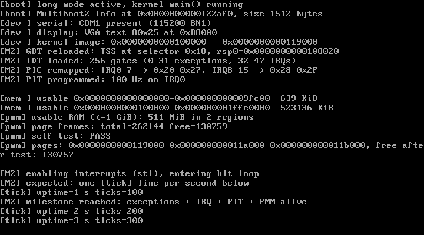
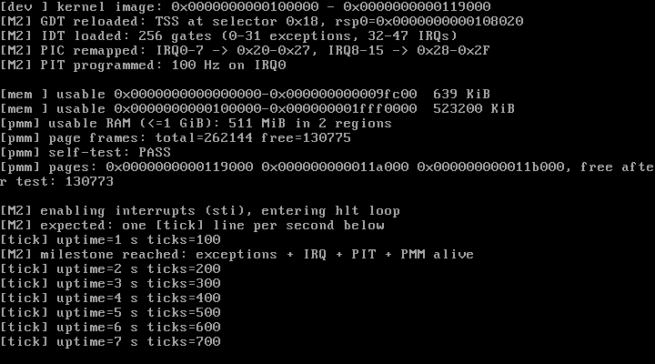

# M2 — Interrupts, Timer and Physical Memory（中断、定时器与物理内存）

> 状态：**已完成并通过实测**  
> 日期：2026-10-27  
> 关联文档：[design.md](./design.md) · [M1-boot.md](./M1-boot.md)

---

## 1. 里程碑定义与范围

**目标**：在 M1 的 64 位 C 内核基础上，把 x86_64 的"第二个大魔王"——中断与异常体系——完整打通，并具备可用的物理内存管理基础：

- GDT 中加入 64 位 TSS 描述符并 `ltr`（为将来 Ring 3 → Ring 0 的中断栈切换做准备）；
- 256 项 IDT；0–31 异常、32–47 硬件 IRQ 全部有汇编桩；
- 统一的寄存器现场结构 `registers_t`，异常可打印现场并 `panic`；
- 8259A PIC 重映射到 `0x20–0x2F`；
- 8254 PIT 以 100 Hz 触发 IRQ0，形成系统心跳；
- 解析 Multiboot2 memory map，实现 4 KiB 页的 Bitmap 物理页分配器并自检。

**范围外（留给后续）**：用户态、系统调用、每进程页表、内核堆、调度器、APIC、SMP、UEFI。

---

## 2. 交付物

| 文件 | 作用 |
| --- | --- |
| `kernel.c` | 重写为 M2 的初始化编排：UART/VGA → GDT/TSS → IDT → PIC → PIT → PMM → `sti` |
| `include/types.h` | 自研定宽类型、`bool`、`static_assert`（不依赖 libc） |
| `include/io.h` | `inb/outb/inw/outw/io_wait` |
| `include/kprintf.h` / `libk/kprintf.c` | 从 M1 拆出的 `kprintf`（串口 + VGA，无 libc/libgcc） |
| `include/panic.h` / `libk/panic.c` | `panic()`：打印后 `cli; hlt` |
| `include/uart.h` / `drivers/uart.c` | 16550 驱动 + **存在性探测**（无串口环境不卡死） |
| `include/vga.h` / `drivers/vga.c` | 80×25 文本控制台 |
| `include/x86_64/gdt.h` / `arch/x86_64/gdt.c` | GDT + 64 位 TSS + `ltr 0x18` |
| `include/x86_64/idt.h` / `arch/x86_64/idt.c` | IDT、异常分派、异常现场打印 |
| `include/x86_64/isr.h` | `registers_t`（与汇编栈布局一一对应） |
| `arch/x86_64/isr_asm.S` | 48 个异常/IRQ 桩、统一入口、跳表、`iretq` |
| `include/x86_64/irq.h` / `arch/x86_64/irq.c` | PIC 重映射、PIT 100 Hz、EOI、tick 计数与心跳日志 |
| `include/multiboot2.h` / `mm/multiboot2.c` | Multiboot2 tag 遍历、memory map 查找 |
| `include/pmm.h` / `mm/pmm.c` | 物理页 Bitmap 分配器 + 自检 |
| `Makefile` | 多目录构建、`test` / `test-exception` 自动验证 |
| `linker.ld` | 新增 `_kernel_start` / `_kernel_end` 供 PMM 保留内核镜像 |
| `grub.cfg` | GRUB 输出仅走 VGA（兼容无串口的 VirtualBox） |
| `docs/m2-vga.png` | M2 实测 VGA 截图（QEMU） |
| `docs/m2-vbox.png` | M2 实测截图（VirtualBox 7.2.16） |

---

## 3. 初始化顺序（kernel_main）

```
uart_init() / vga_init()
        │
        ├─ GDT + TSS       kprintf("[M2] GDT reloaded ...")
        ├─ IDT (256 gates) kprintf("[M2] IDT loaded ...")
        ├─ PIC remap       kprintf("[M2] PIC remapped ...")
        ├─ PIT 100 Hz      kprintf("[M2] PIT programmed ...")
        ├─ PMM init        kprintf("[mem ] ...", "[pmm] ...")
        ├─ PMM self-test   kprintf("[pmm] self-test: PASS")
        │
        └─ sti  → for(;;) hlt
                └─ 每 100 次中断：kprintf("[tick] uptime=... s ticks=...")
                       第 100 次额外打印 "[M2] milestone reached ..."
```

顺序很重要：**IDT 必须在任何可能触发异常的代码之前装好；PIC/PIT 必须在 `sti` 之前配置好**，否则第一个定时器中断就会打到一个空/错误的门。

---

## 4. 关键实现细节

### 4.1 GDT + 64 位 TSS

boot.S 里的临时 GDT 只够进入长模式。M2 在 C 中重建 GDT（5 个 8 字节槽）：

| 选择子 | 描述 |
| --- | --- |
| `0x00` | null |
| `0x08` | 64 位内核代码（`0x9A`，gran `0xA0`） |
| `0x10` | 内核数据（`0x92`） |
| `0x18` | **64 位 TSS**（占两个槽，共 16 字节） |

TSS 结构（`struct tss64`，104 字节，packed）包含 `rsp0/rsp1/rsp2`、7 个 IST 指针与 I/O map base。M2 设置：

- `tss.rsp0 = tss_stack + 16 KiB`（一个静态内核栈）；
- `tss.iomap_base = sizeof(tss)`（超出 limit，表示没有 I/O 权限位图）；
- 用 `lgdt` 加载新 GDT，重载 DS/ES/SS/FS/GS（CS 仍是 `0x08`，新 GDT 中语义相同），最后 `ltr 0x18`。

> M2 仍只在 Ring 0 运行，但 TSS 与 RSP0 已经配好；M3 进入用户态时不再返工。

### 4.2 IDT（256 门）

`struct idt_entry` 为 16 字节，`offset` 分低/中/高三段；`flags = 0x8E`（present、DPL 0、64 位中断门），`selector = 0x08`。0–47 使用 48 个专用桩，48–255 指向 `isr_default`。入口用 `lidt` 装载。

### 4.3 汇编桩与 `registers_t`

每个异常/IRQ 桩：

- 不带错误码：`pushq $0`（伪造 err_code）→ `pushq $vector` → `jmp isr_common`；
- 自带错误码（8, 10, 11, 12, 13, 14, 17, 21, 29, 30）：只 `pushq $vector`，**不能再压 err_code**。

`isr_common` 的保存顺序（与 `registers_t` 从低地址到高地址一一对应）：

```
r15 r14 r13 r12 r11 r10 r9 r8 rbp rdi rsi rdx rcx rbx rax | int_no err_code | rip cs rflags rsp ss
```

栈对齐处理（System V AMD64 ABI 要求调用 C 前 RSP 16 字节对齐）：

```asm
movq %rsp, %rdi      # registers_t *regs
movq %rsp, %rbp      # 暂存原始 RSP（rbp 是 callee-saved，C 不会破坏）
andq $-16, %rsp      # 对齐
call isr_handler
movq %rbp, %rsp      # 恢复
```

`registers_t` 的布局同时用 `static_assert(sizeof(registers_t) == 22 * 8, ...)` 锁死，防止以后改结构体却忘了改汇编。

### 4.4 异常处理

`isr_handler()` 对 `int_no < 32` 的向量：

1. 打印 `vector`、异常名（0–31 名称表）、`err_code`；
2. 打印 `RIP / CS / RFLAGS / RSP / SS`；
3. 若是 `#PF`（14），读 `CR2` 打印出错地址；
4. 调用 `panic()`。

`int_no >= 32` 直接交给 `irq_handler()`。

### 4.5 PIC 重映射与 EOI

标准 ICW1–ICW4 序列，把主片 IRQ0–7 映射到 `0x20–0x27`、从片 IRQ8–15 映射到 `0x28–0x2F`，从片接在主片 IRQ2 上。初始化后先屏蔽全部 IRQ，再由 `pit_init()` 单独放开 IRQ0。

中断返回前发送 EOI：来自从片的 IRQ（向量 ≥ 40）先给从片发 EOI，再给主片发 EOI。

### 4.6 PIT 100 Hz

- 输入时钟 1,193,182 Hz，`divisor = 1193182 / 100 = 11931`；
- 通道 0、模式 3（方波）、先低后高字节（命令字 `0x36`）；
- 每 tick `ticks++`；每 100 tick（约 1 秒）打印 `[tick] uptime=N s ticks=100N`；
- 第 100 tick 打印 M2 里程碑标记。

### 4.7 Multiboot2 memory map

从 GRUB 传入的 info 指针开始，跳过 8 字节头，按 `size` 与 8 字节对齐遍历 tag，找到 type=6 的 memory map tag；entry 为 `{addr, len, type, reserved}`，其中 type=1 表示可用 RAM。

### 4.8 物理页 Bitmap 分配器

- 管理范围：前 **1 GiB**（与恒等映射一致），4 KiB 页 → 262,144 个页帧，位图 32 KiB（静态 `.bss`）；
- 初始全部标为"占用"，再按 memory map 的可用区域清零；
- 重新保留：低 1 MiB（BIOS/VGA/实模式）、内核镜像 `[_kernel_start, _kernel_end)`、Multiboot2 info 结构；
- `pmm_alloc_page()`：从上次分配位置 first-fit 扫描并回绕；`pmm_free_page()`：校验对齐/范围/是否已占用；
- 自检：连续分配 3 页 → 每页写入 512 个 64 位模式 → 回读校验 → 释放 1 页并校验空闲页数 +1。

> 分配器位图本身就在内核 `.bss` 里，而 `_kernel_end` 已包含它，因此不会把自己分配出去。

### 4.9 UART 存在性探测（VirtualBox 友好）

不是所有虚拟机都配置了串口。`uart_init()` 先写 16550 的 scratch 寄存器（offset 7）再读回：

- 读回一致 → UART 存在，正常初始化；
- 不一致（如未配置串口的 VirtualBox）→ 标记为不存在，`uart_putc()` 直接返回。

这样内核在无串口环境只使用 VGA，不会因为死等 UART 的 THR-empty 位而挂起。同时 `grub.cfg` 也移除了把 GRUB 输出镜像到 COM1 的配置。

---

## 5. 内存布局（M2 实测）

| 物理地址 | 内容 |
| --- | --- |
| `0x0000_0000 – 0x0000_09FC00` | 低端可用内存（PMM 保留低 1 MiB） |
| `0x000B_8000` | VGA 文本缓冲区 |
| `0x0010_0000` | `_kernel_start`：Multiboot2 头、`.text`、`.rodata`、`.data`、`.bss` |
| `0x0010_0000 – 0x0011_9000` | 内核镜像（`_kernel_end = 0x119000`；含 IDT 4 KiB、TSS 16 KiB 栈、PMM bitmap 32 KiB） |
| `0x0012_2AF0` | Multiboot2 info（正常构建实测，随内核大小浮动） |
| `0x0010_0000 – 0x1FFE_0000` | QEMU `-m 512M` 的可用 RAM（PMM 管理） |

PMM 实测统计：

```
[mem ] usable 0x0000000000000000-0x000000000009fc00  639 KiB
[mem ] usable 0x0000000000100000-0x000000001ffe0000  523136 KiB
[pmm] usable RAM (<=1 GiB): 511 MiB in 2 regions
[pmm] page frames: total=262144 free=130759
```

（`free=130759` 页 ≈ 510.8 MiB，已扣除内核镜像、低 1 MiB 与 Multiboot2 info。）

---

## 6. 构建、运行与测试

```bash
cd ~/lantest

make                    # 构建 kernel.elf + lantest.iso
make test               # 无头启动：要求出现 tick 中断与 PMM 自检 PASS
make test-exception     # 构造 #PF：要求打印异常现场并进入 PANIC
make run                # QEMU 图形窗口
make run-nographic      # 串口输出到终端
make debug / make gdb   # QEMU + GDB
make clean
```

`make test` 的判定条件（两条同时满足）：

1. 串口日志出现 `milestone reached`（说明 PIT 已产生 ≥100 次中断，异常/IRQ 通路正常）；
2. 串口日志出现 `[pmm] self-test: PASS`。

`make test-exception` 使用 `-DLANTEST_EXCEPTION_TEST` 编译一个临时 ISO，故意写 `0x200000000`（超出 1 GiB 恒等映射）触发页错误；验证后自动 `make clean`，不会污染正常构建。

---

## 7. 实测记录（2026-10-27）

### 7.1 构建

- 多目录构建零警告（GCC 15.2.0，`-std=gnu11 -Wall -Wextra`）；
- `kernel.elf` 65,168 字节，`lantest.iso` 5,591,040 字节（2730 个 ISO 扇区）。

### 7.2 启动 + tick + PMM（`make test` → PASS）

```
==================================================
  Lantest OS  -  M2: interrupts, timer, memory
  independent x86_64 kernel, no Linux code/ABI
==================================================

[boot] long mode active, kernel_main() running
[boot] Multiboot2 info at 0x0000000000122af0, size 1512 bytes
[dev ] serial: COM1 present (115200 8N1)
[dev ] display: VGA text 80x25 at 0xB8000
[dev ] kernel image: 0x0000000000100000 - 0x0000000000119000
[M2] GDT reloaded: TSS at selector 0x18, rsp0=0x0000000000108020
[M2] IDT loaded: 256 gates (0-31 exceptions, 32-47 IRQs)
[M2] PIC remapped: IRQ0-7 -> 0x20-0x27, IRQ8-15 -> 0x28-0x2F
[M2] PIT programmed: 100 Hz on IRQ0

[mem ] usable 0x0000000000000000-0x000000000009fc00  639 KiB
[mem ] usable 0x0000000000100000-0x000000001ffe0000  523136 KiB
[pmm] usable RAM (<=1 GiB): 511 MiB in 2 regions
[pmm] page frames: total=262144 free=130759
[pmm] self-test: PASS
[pmm] pages: 0x0000000000119000 0x000000000011a000 0x000000000011b000, free after test: 130757

[M2] enabling interrupts (sti), entering hlt loop
[M2] expected: one [tick] line per second below
[tick] uptime=1 s ticks=100
[M2] milestone reached: exceptions + IRQ + PIT + PMM alive
[tick] uptime=2 s ticks=200
[tick] uptime=3 s ticks=300
...
```

连续运行 15 秒无异常，tick 严格保持 100 Hz。

### 7.3 异常路径（`make test-exception` → PASS）

故意访问 `0x200000000`（8 GiB，超出恒等映射）触发 `#PF`：

```
[test] deliberate page fault at 0x200000000 (expect #PF panic)

==================================================
  CPU EXCEPTION 14: page fault
==================================================
[exc ] err_code=2
[exc ] rip=0x0000000000101180 cs=8 rflags=10002
[exc ] rsp=0x0000000000118fd0 ss=10
[exc ] cr2=0x0000000200000000 (faulting address)

==================================================
  KERNEL PANIC: unhandled CPU exception
==================================================
[panic] system halted (cli; hlt)
```

验证要点：

- `err_code=2` 表示写操作 + 页不存在（与故意写操作一致）；
- `CR2` 精确指向 `0x200000000`；
- 异常桩正确保存了 `CS=0x08 / SS=0x10 / RFLAGS`，说明错误码桩与 `registers_t` 布局一致；
- 处理器打印现场后进入 `panic` 并 `cli; hlt`，没有 triple fault。

### 7.4 VGA 实测



### 7.5 VirtualBox 实测（7.2.16）

在 Windows 宿主机上用 `VBoxManage` 创建临时 BIOS 虚拟机（512 MB、IDE CD、`vboxvga`、**不配置串口**），直接挂载 `lantest.iso` 启动：

- GDT/TSS、IDT、PIC、PIT 全部正常初始化；
- Multiboot2 内存图解析为 2 个可用区域（`total=262144 free=130775`）；
- `[pmm] self-test: PASS`；
- `sti` 之后 tick 连续运行到 23 秒以上（`ticks=2300`），无 triple fault；
- 未配置串口时内核自动降级为仅 VGA 输出，直接验证了 UART 探测逻辑。



### 7.6 调试链路

`make debug` + `make gdb` 沿用 M1 的 QEMU `-s -S` + 硬件断点方案；M2 下 `kernel_main` 断点、继续执行、tick 日志均正常。

---

## 8. 已知限制

1. **PMM 只管理前 1 GiB**（与恒等映射一致）；更大内存需要 M3 的虚拟内存方案。
2. **没有虚拟内存/页表管理**：分配的物理页只能通过恒等映射直接访问。
3. **#DF 没有独立 IST 栈**：双故障仍使用当前栈；M3 建议配置 IST1。
4. **PIC/PIT 为传统设备**：后续迁移 APIC/IOAPIC/APIC timer。
5. **异常不恢复**：所有 CPU 异常直接 panic；缺页按需分页留到 M3。
6. **中断处理仍是单核无锁**：`ticks` 是 `volatile u64`，当前单核够用。
7. **串口为轮询模式**（未接中断），只用于日志。
8. **VGA 文本模式限制**：80×25，无颜色/字体控制；后期换帧缓冲。
9. **用户态未启用**：TSS.RSP0 已配置但尚未被 Ring 3 中断实际使用。

---

## 9. 下一步（M3 计划）

1. **内核堆**：基于 PMM 的 `kmalloc/kfree`（先 bump + free-list）。
2. **虚拟内存**：每进程页表、用户/内核地址空间划分、`map/unmap`、按需分页（把 `#PF` 变成可恢复事件）。
3. **用户态**：Ring 3 任务、TSS.RSP0 实际生效、`syscall`/`sysret` 入口。
4. **自定义 syscall ABI**：按 design.md 的草案实现 `exit/write/read/brk/getpid/yield`。
5. **RR 调度器**：任务结构、上下文切换、PIT 驱动抢占。
6. **双故障 IST**（顺手项）与异常恢复框架。

验收标准：能运行一个 Ring 3 用户程序，通过自定义 syscall 输出字符串并正常退出，调度器可在两个任务间轮转。

---

## 10. 踩坑与经验

| 问题 | 现象 | 解决 |
| --- | --- | --- |
| GCC 15 默认 `-std=gnu23` | `typedef _Bool bool;` 报错（`bool` 已是关键字） | Makefile 显式 `-std=gnu11` |
| 中断桩栈对齐 | C handler 内可能触发 GPF / 崩溃 | `andq $-16, %rsp` 对齐，用 callee-saved `rbp` 保存原始 RSP |
| 错误码异常 | 若给 #PF 等再 `push $0`，`registers_t` 全错位 | 按 Intel 手册列出 10 个自带错误码的向量，桩不重复压栈 |
| `rep stosl` / PMM 位图归属 | 分配器可能把自己（内核 `.bss`）分配出去 | `_kernel_end` 覆盖位图，PMM 初始化时保留整个内核镜像 |
| 无串口环境 | 轮询 UART 可能永久等待 | scratch 寄存器探测 + 有界自旋 |
| 跨系统 I/O | `/mnt/c` 构建随文件增多变慢 | 项目迁移到 WSL 家目录 `~/lantest`，构建约亚秒级 |
| `ld -nostdlib` | M1 草案中的无效参数 | 使用 `ld -T linker.ld ...` 正确链接 |
| 测试 grep 模式 | `[pmm] self-test: PASS` 被写成 `pmm self-test` 导致误报 FAIL | 按日志实际格式匹配（含 `]`） |

---

## 11. 复现清单

- [x] 多目录构建零警告
- [x] GDT/TSS 加载成功（`ltr 0x18`，RSP0 已设置）
- [x] IDT 256 门加载成功
- [x] PIC 重映射到 `0x20–0x2F`
- [x] PIT 100 Hz，tick 连续 15 秒稳定
- [x] Multiboot2 内存图解析（2 个可用区域）
- [x] PMM 自检 PASS（分配/写读/释放/计数）
- [x] 故意 `#PF` 触发异常现场打印 + PANIC，无 triple fault
- [x] `make test` / `make test-exception` 自动判定通过
- [x] VGA 截图与串口日志均已归档
- [x] VirtualBox 7.2.16 实测：GDT/IDT/PIC/PIT/PMM/tick 全部正常
