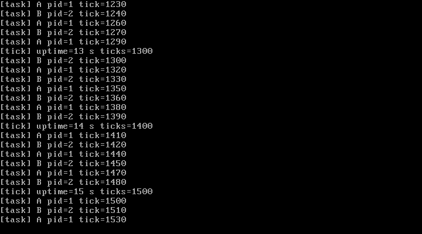

# M3 (第一阶段) — 内核堆、任务与轮转调度

> 状态：**M3a 已完成并通过实测**（内核堆 + 上下文切换 + RR 调度）；Ring 3 / syscall 留待 M3b  
> 日期：2026-10-27  
> 关联文档：[design.md](./design.md) · [M2-core.md](./M2-core.md)

---

## 1. 本阶段范围

按"先堆、再上下文、最后 Ring 3"的顺序，M3a 完成前两步：

1. **PMM 连续页分配**（内核栈与堆区需要物理连续，恒等映射下才能直接使用）；
2. **kmalloc / kfree 自由链表内核堆**：块头、分割、合并、统计与启动自检；
3. **任务结构与内核栈**：`struct task`、每任务 16 KiB 内核栈、初始上下文伪造；
4. **`switch_to` 汇编**：保存/恢复 callee-saved 寄存器，切换内核栈；
5. **环形 RR 调度器**：PIT 100 Hz、每 10 tick（100 ms）抢占一次；
6. **两个 Ring 0 内核线程**交替打印，验证上下文切换与抢占；
7. **kprintf 中断原子化**，避免调度/日志重入；
8. QEMU 与 VirtualBox 双平台实测。

**不在本阶段**：用户态 Ring 3、`iretq` 跳转用户程序、系统调用、每进程页表、优先级调度。

---

## 2. 交付物

| 文件 | 作用 |
| --- | --- |
| `include/pmm.h` / `mm/pmm.c` | 新增 `pmm_alloc_pages()` / `pmm_free_pages()` 连续页分配，并扩展自检 |
| `include/kmalloc.h` / `mm/kmalloc.c` | **新增**：自由链表内核堆（region、块头、first-fit、分割、合并、自检、统计） |
| `include/task.h` | **新增**：`struct task`（`rsp` 固定在 offset 8）、状态、调度器接口 |
| `sched/scheduler.c` | **新增**：任务创建、初始栈帧、环形 RR、`schedule()`、`task_bootstrap()` |
| `arch/x86_64/switch.S` | **新增**：`switch_to()` 与首次进入的 `task_trampoline` |
| `libk/kprintf.c` | 修改：每行输出期间关中断，保证与定时器/调度互斥 |
| `arch/x86_64/irq.c` | 修改：PIT tick 驱动 `schedule()`（先发 EOI 再切换） |
| `kernel.c` | 修改：kmalloc 自检、创建两个内核线程、启动调度器；boot 任务进入 `sti; hlt` 空闲循环 |
| `Makefile` | 新源文件、M3 版 `make test` 判定（kmalloc PASS + 调度器启动 + A/B 输出） |
| `docs/m3-vbox.png` | VirtualBox 实测截图 |

---

## 3. 设计

### 3.1 为什么需要 `pmm_alloc_pages()`

M2 的 PMM 只按 4 KiB 单页分配。内核栈需要 16 KiB **物理连续**内存；kmalloc 的堆区也假设连续（恒等映射下物理地址就是可访问地址）。因此新增：

```c
u64  pmm_alloc_pages(u32 count);   /* 扫描位图找 count 个连续空闲页 */
void pmm_free_pages(u64 addr, u32 count);
```

自检中新增"分配 4 页连续内存 → 写入/校验 → 释放"的步骤。

### 3.2 kmalloc / kfree：自由链表 + 合并

堆由若干 **region** 组成，每个 region 是一段从 PMM 申请的连续页（默认 8 页 = 32 KiB，大请求按需扩大）。region 内切成块：

```
+----------------+-------------------------------------+------------------+
| block header   | payload（16 字节对齐）              | 下一个 block ... |
| size|free|magic|                                     |                  |
+----------------+-------------------------------------+------------------+
```

- 块头 16 字节：`size`（含头总大小）、`free`、`magic = "KBLK"`、保留；
- `kmalloc(size)`：`need = align16(size) + 16`；在 region 中 **first-fit**；若剩余空间 ≥ 块头 + 16 字节则分割；
- region 不够时按需向 PMM 申请新 region（最多 16 个）；
- `kfree(ptr)`：校验对齐/magic/重复释放/归属 region，标记空闲后**向后合并**连续空闲块，再从头遍历**向前合并**；
- `kmalloc_stats()` 提供 region 数、已用/空闲字节、最大空闲块，供自检和日志使用；
- 自检：分配 16/64/1000/3000/5000 字节，写入并回读模式，乱序释放；断言 `used == 0`、`free == sum(region sizes)`、`largest == 最大 region`（即全部合并回大块），输出 PASS。

实测（QEMU、VirtualBox 相同）：

```
[kmalloc] self-test: PASS
[kmalloc] regions=1 used=0 free=32768 largest=32768
```

### 3.3 任务结构与内核栈

```c
struct task {
    u64 pid;
    u64 rsp;          /* 必须位于 offset 8：switch.S 直接写 8(%rdi) */
    u64 cr3;          /* 留待 M3b 每进程地址空间 */
    u8 *kernel_stack;
    u64 stack_size;
    void (*entry)(void);
    char name[16];
    u32 state;
    u32 ticks;
    struct task *next;
};
```

编译期用 `static_assert(__builtin_offsetof(struct task, rsp) == 8, ...)` 锁死与汇编的约定。

每个内核线程从 PMM 申请 **4 页 = 16 KiB** 内核栈，并在栈顶伪造"被 `switch_to` 切换出去"的现场：

```
低地址                                  高地址
[r15][r14][r13][r12][rbp][rbx][task_trampoline]   ← task->rsp 指向 r15
```

`switch_to` 依次 `pop r15..rbx` 后 `ret`，于是第一次被调度时跳到 `task_trampoline`；trampoline 做 `sti; call task_bootstrap`，由 C 代码调用线程入口。

### 3.4 `switch_to` 汇编

```asm
switch_to:
    pushq %rbx
    pushq %rbp
    pushq %r12
    pushq %r13
    pushq %r14
    pushq %r15
    movq %rsp, 8(%rdi)      /* prev->rsp = rsp */
    movq 8(%rsi), %rsp      /* rsp = next->rsp */
    popq %r15
    popq %r14
    popq %r13
    popq %r12
    popq %rbp
    popq %rbx
    ret
```

只保存 callee-saved 寄存器（SysV AMD64 ABI 要求）；从定时器 IRQ 抢占时，中断桩已经保存了其余全部寄存器。`ret` 返回后，若 next 是老任务，就回到它上次 `switch_to` 的调用点；若是新任务，则跳进 `task_trampoline`。

### 3.5 环形 RR 调度与 PIT 抢占

- 任务队列是**环形单链表**，boot 任务（`kernel_main` 所在上下文）是链表头；
- `schedule()` 从 `current->next` 开始找第一个 READY/RUNNING 任务；只跳过 DEAD；
- `irq_handler()` 在 PIT 每个 tick 累加 `ticks`，**先发 EOI**，再在 `ticks % 10 == 0` 时调用 `schedule()`：
  - 先 EOI 可保证切换后 PIC 仍能继续投递下一次 IRQ0；
  - 切换后，被挂起的任务恢复时从它自己的 IRQ 处理路径返回，`iretq` 恢复 RFLAGS（包括 IF）。
- 时间片 10 tick = 100 ms；两个内核线程外加 boot 任务轮流获得 CPU。

### 3.6 两个内核线程与"IF 陷阱"

```c
static void kthread_a(void) {
    for (;;) {
        kprintf("[task] A pid=%lu tick=%lu\n", task_current()->pid, timer_ticks());
        wait_ticks(20);   /* 约 200 ms */
    }
}
```

关键修复：boot 任务第一次 `schedule()` 是从普通函数调用路径切走的，**不经过 IRQ**；当它从别的任务的 IRQ 上下文被切换回来时，CPU 的 IF 仍为 0（中断门清掉了它）。如果空闲循环只写 `hlt`，就会永远睡死。因此 boot 空闲循环必须：

```c
for (;;) {
    __asm__ volatile ("sti");
    __asm__ volatile ("hlt");
}
```

新线程的 `task_trampoline` 也执行 `sti` 后才调用 C 入口，所以线程不会遇到这个问题。

### 3.7 kprintf 原子化

`kprintf` 在输出整行期间 `cli`，结束后用保存的 RFLAGS 恢复（`pushfq/popfq`）。这样：

- 定时器中断不会在打印中途抢占，避免 VGA 光标/串口输出交错；
- 调度器不会在 `kprintf` 内部切换任务；
- IRQ 内打印（tick 心跳）也不会与任务打印重入。

---

## 4. 初始化顺序（kernel_main）

```
gdt / idt / pic / pit
pmm_init + pmm_self_test           (M2)
kmalloc_init + kmalloc_self_test   (M3a)
scheduler_init
task_create_kernel("kthread-a", ...)
task_create_kernel("kthread-b", ...)
sti
schedule()          ← 第一次切换；boot 任务稍后会被调度回来
for (;;) { sti; hlt; }   ← boot 任务空闲循环
```

---

## 5. 实测记录（2026-10-27）

### 5.1 QEMU：`make test` → PASS

```
[kmalloc] self-test: PASS
[kmalloc] regions=1 used=0 free=32768 largest=32768

[M3] scheduler initialized: 3 tasks in the run queue
[M3] starting round-robin: PIT slice = 100 ms, 2 kernel threads
[M3] scheduler running: kernel thread kthread-a (pid=1) started
[task] A pid=1 tick=1
[M3] scheduler running: kernel thread kthread-b (pid=2) started
[task] B pid=2 tick=10
[task] A pid=1 tick=30
[task] B pid=2 tick=40
...
[tick] uptime=14 s ticks=1400
[task] A pid=1 tick=1410
[task] B pid=2 tick=1420
```

15 秒内 A/B 各输出约 **49 行**，严格交替，tick 稳定 100 Hz。

### 5.2 异常路径回归

`make test-exception` 仍 PASS：故意触发 `#PF` → 打印异常现场 → `KERNEL PANIC`，无 triple fault。

### 5.3 QEMU 图形模式

`make run`（WSLg 窗口）8 秒内 A/B 各 25 行，串口与 VGA 同步输出正常。

### 5.4 VirtualBox 7.2.16 实测

临时 BIOS 虚拟机（512 MB、IDE CD、`vboxvga`、COM1 接文件）挂载 `lantest.iso` 启动，串口日志：

- `[pmm] self-test: PASS`
- `[kmalloc] self-test: PASS`
- `[M3] scheduler running: kernel thread kthread-a (pid=1) started`
- A/B 交替输出，15 秒内分别 52 / 51 行；tick 到 `uptime=15 s ticks=1500`
- 截图见下，VGA 与串口一致。



---

## 6. 踩坑记录

| 问题 | 现象 | 解决 |
| --- | --- | --- |
| boot 任务恢复后 IF=0 | 第一次从普通调用路径切走后，再被切换回来，空闲循环 `hlt` 永久睡死 | 空闲循环改为 `sti; hlt`；新线程 trampoline 也先 `sti` |
| kprintf 重入/交错 | 定时器抢占打印中的任务，VGA 光标错乱 | kprintf 整行关中断（`pushfq; cli` … `popfq`） |
| EOI 与切换顺序 | 在 IRQ 里先切换、后 EOI 会丢 tick | 先发 EOI，再调用 `schedule()` |
| 物理连续性 | 内核栈/堆区在恒等映射下要求物理连续 | 新增 `pmm_alloc_pages()` 连续分配 |
| 结构体与汇编偏移 | `switch_to` 硬编码 `8(%rdi)` | `static_assert(__builtin_offsetof(struct task, rsp) == 8)` |
| 首次调度栈对齐 | 新任务通过 `ret` 进入 trampoline，栈需满足 SysV ABI | 伪造栈帧后 rsp = stack_top（16 对齐），trampoline 中 `call` C 入口 |
| 线程输出过快 | 串口/VGA 刷屏 | 每个线程两行间等待 20 tick（~200 ms） |

---

## 7. 已知限制

1. **单 CPU、无锁**：`kmalloc/kfree`、调度器都假设单核且不会被中断重入；SMP 前必须加锁。
2. **所有任务共享内核页表**：`task->cr3` 尚未使用，没有地址空间隔离；Ring 3 需要每进程 PML4。
3. **只有 Ring 0 内核线程**：用户态、`iretq`、syscall 尚未实现；TSS.RSP0 也还没在任务切换时更新。
4. **堆不可收缩**：region 只增不减，最多 16 个；`kfree` 不归还整块 region 给 PMM。
5. **调度器简单**：O(n) 选任务、无 sleep/wait 队列、无优先级/时间片配额；DEAD 任务不回收。
6. **抢占只在 tick 边界**：没有即时优先级抢占；`kprintf` 期间关中断会短暂延迟 tick。
7. **`make test` 依赖 A/B 输出次数**，在极慢宿主机上可能需要放宽超时（当前 15 s 足够）。

---

## 8. 下一步（M3b）

1. 每任务页表（PML4）与低地址用户空间映射，CR3 切换；
2. `TSS.RSP0` 随任务切换更新；
3. 伪造 `iretq` 栈进入 Ring 3（SS/RSP/RFLAGS/CS/RIP）；
4. 自定义 syscall ABI：`syscall`/`sysret` 或自研中断门；实现 `exit`、`write`、`getpid`、`yield`；
5. 用户程序加载（平坦二进制或极简 ELF）；
6. 任务退出/回收、`wait`、睡眠队列与更完整的调度策略。

---

## 9. 复现清单

- [x] `pmm_alloc_pages()` 连续页自检 PASS
- [x] `kmalloc` 自检 PASS（分配/写读/乱序释放/全合并）
- [x] `struct task` 与 `switch_to` 偏移/栈帧约定（编译期断言）
- [x] 环形 RR 调度 + PIT 100 ms 抢占
- [x] 两个内核线程 A/B 持续交替输出（QEMU 15 s：49/49 行）
- [x] `make run` 图形模式正常
- [x] `make test-exception` 回归 PASS
- [x] VirtualBox 7.2.16 实测（串口 + VGA 截图，A/B 52/51 行，tick 到 1500）
- [x] 多目录构建零警告（GCC 15.2.0，`-std=gnu11 -Wall -Wextra`）
