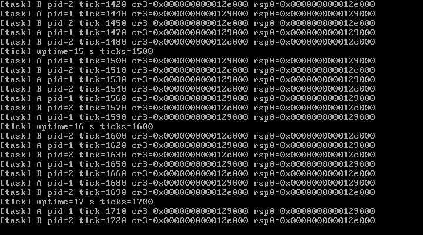

# M3b Step 1 — 每任务 PML4 与 CR3 切换

> 状态：**Step 1 已完成并通过实测**（QEMU 10.2.1 + VirtualBox 7.2.16）  
> 日期：2026-10-27  
> 关联文档：[design.md](./design.md) · [M3-heap-sched.md](./M3-heap-sched.md)

---

## 1. 本步目标与边界

M3b 的第一步只做**地址空间切换的地基**，不碰 Ring 3：

1. 每个任务拥有独立 PML4；
2. 新 PML4 复制当前内核映射（恒等映射、代码、栈、堆、页表自身）；
3. 上下文切换时把 `next->cr3` 写入 CR3（切换地址空间）；
4. 每个任务的内核栈顶写入 TSS.RSP0（为 Ring 3 中断入口准备）；
5. 在 `kernel_main` 中做一次**主动 CR3 切换自检**，再让调度器自动切换；
6. 内核线程 A/B 继续交替输出，并打印各自运行时的 CR3 / RSP0。

**不在本步**：Ring 3、`iretq`、用户页表映射、系统调用、每进程用户栈。

---

## 2. 交付物

| 文件 | 变化 |
| --- | --- |
| `include/x86_64/paging.h` | **新增**：读/写 CR3、当前 PML4、创建任务 PML4 |
| `arch/x86_64/paging.c` | **新增**：`paging_create_kernel_pml4()` 从 PMM 取页并复制内核 PML4 表项 |
| `include/x86_64/gdt.h` / `arch/x86_64/gdt.c` | 新增 `gdt_set_tss_rsp0()`，在任务切换时更新 TSS.RSP0 |
| `sched/scheduler.c` | `task->cr3` 真正启用；`schedule()` 切换 CR3 与 TSS.RSP0 |
| `kernel.c` | 打印任务 PML4、CR3 切换自检、线程行加入 `cr3=` / `rsp0=` |
| `Makefile` | 加入 `paging.c`；`make test` 增加 CR3 自检与 `cr3=` 判定 |
| `docs/m3b-vbox.png` | VirtualBox 实测截图 |

---

## 3. 实现细节

### 3.1 任务 PML4 的创建

```c
u64 paging_create_kernel_pml4(void)
{
    u64 new_phys = pmm_alloc_page();          /* 4 KiB PML4 */
    u64 *dst = (u64 *)(usize)new_phys;        /* 恒等映射，可直接访问 */
    const u64 *src = (const u64 *)(usize)paging_read_cr3();

    for (u32 i = 0; i < 512; ++i)
        dst[i] = src[i];                      /* 共享内核映射 */

    return new_phys;
}
```

当前内核占用的 PML4[0] 映射了低 1 GiB（2 MiB 大页），所以直接复制 512 项即可让新地址空间拥有完整的代码/数据/栈/IDT/页表访问能力。**每个任务只是 PML4 页不同，底层 PDPT/PD 仍共享**。

### 3.2 切换 CR3 与 TSS.RSP0

调度器在 `switch_to` 之前完成两件事：

```c
if (next->cr3 != 0 && next->cr3 != paging_read_cr3())
    paging_write_cr3(next->cr3);

gdt_set_tss_rsp0(next->kernel_stack != NULL
                     ? (u64)(next->kernel_stack + next->stack_size)
                     : boot_rsp0);            /* boot 任务用原始 RSP0 */
```

- `paging_write_cr3()` 同时刷新非全局 TLB；
- 由于所有任务的 PML4 都包含同一套内核映射，**在切换 CR3 的瞬间执行流仍然有效**；
- TSS.RSP0 现在是 per-task 的，Ring 3 中断进入内核时会自动切到该任务的内核栈（本步只在 Ring 0 运行，暂未真正使用，但已就绪并打印验证）。

### 3.3 主动 CR3 自检

在启动调度器之前，`kernel_main` 依次把 CR3 切到任务 A、任务 B 的 PML4：

1. 读回 CR3 确认写入生效；
2. 访问一个 `kmalloc` 缓冲区并校验内容（证明内核代码/数据/堆在切换后仍可访问）；
3. 恢复 boot CR3 并再次校验。

```
[M3b] per-task PML4: boot=0x0000000000113000, kthread-a=0x0000000000129000, kthread-b=0x000000000012e000
[M3b] CR3 -> kthread-a (0x0000000000129000): identity probe ok
[M3b] CR3 -> kthread-b (0x000000000012e000): identity probe ok
[M3b] CR3 switch self-test: PASS
```

### 3.4 线程运行时证据

两个内核线程在每次打印时读取真实 CR3 与 TSS.RSP0：

```
[task] A pid=1 tick=1  cr3=0x0000000000129000 rsp0=0x0000000000129000
[task] B pid=2 tick=10 cr3=0x000000000012e000 rsp0=0x000000000012e000
[task] A pid=1 tick=30 cr3=0x0000000000129000 rsp0=0x0000000000129000
[task] B pid=2 tick=40 cr3=0x000000000012e000 rsp0=0x000000000012e000
```

不同任务、不同 PML4、不同内核栈，调度器在每次切换时都正确更新了二者。

---

## 4. 测试结果（2026-10-27）

### 4.1 QEMU

- `make test` → **PASS**：A/B 各 49 行，CR3 自检 PASS，kmalloc/PMM 自检 PASS；
- `make test-exception` → **PASS**（故意 `#PF` 仍然走异常现场 + PANIC）；
- `make run` 图形模式正常。

### 4.2 VirtualBox 7.2.16

- 临时 BIOS 虚拟机（512 MB、IDE CD、COM1→文件）启动 M3b ISO；
- 串口日志确认：`boot=0x113000 / A=0x129000 / B=0x12e000`，自检 PASS，A/B 交替，tick 到 **1700**；
- 截图见下。



---

## 5. 下一步（M3b Step 2/3）的设计决定

### 5.1 GDT 需要加入用户段（必须）

当前 GDT 布局：`null(0x00) / kcode(0x08) / kdata(0x10) / TSS(0x18)`。要支持 Ring 3，需要调整为：

| 选择子 | 描述 |
| --- | --- |
| `0x08` | 内核代码（DPL 0） |
| `0x10` | 内核数据（DPL 0） |
| `0x18` | **用户代码（DPL 3）→ `0x1B`** |
| `0x20` | **用户数据（DPL 3）→ `0x23`** |
| `0x28` | TSS（占 0x28/0x30 两个槽，`ltr 0x28`） |

这样 `iretq` 帧中的 `CS=0x1B`、`SS=0x23` 才合法。

### 5.2 用户地址空间放在哪里（关键）

目前内核恒等映射占用 PML4[0]（低 1 GiB）且 U/S=0。若把用户页映射到低地址会与内核映射冲突（替换 PML4[0] 后内核栈/代码就不可见了）。

本项目的方案：

- **M3b 先用 PML4[1]（`0x0000_0080_0000_0000`，512 GiB 处）作为用户空间**：用户代码/栈映射到该槽，PML4/PDPT/PD/PT 各级都设置 U/S=1；
- 内核 PML4[0] 保持 U/S=0，用户态无法访问；
- 后续若需要 POSIX 常见的低地址布局，再迁移到 higher-half 内核（工作量更大）。

### 5.3 `iretq` 与 syscall 顺序

1. 给任务增加用户栈（1 页，映射到 `0x0000_0080_0000_0000 + ...`）；
2. 构造 `iretq` 帧：`RIP=用户入口、CS=0x1B、RFLAGS=0x202、RSP=用户栈顶、SS=0x23`；
3. 进入 Ring 3 前把 DS/ES/FS/GS 置为 `0x23`；
4. IDT 0x80 门设置 DPL=3（`0xEE`），汇编桩保存寄存器后调用 `syscall_handler(rax, rdi, rsi, ...)`，返回值写回中断帧的 `rax`；
5. 先实现 `write`（调用内核 kprintf 输出）与 `exit`（标记任务 DEAD 并调度走）。

### 5.4 仍需注意

- 用户页各级 U/S 位漏设会立刻 `#PF`；
- 进入 Ring 3 后不能再用内核恒等地址（U/S=0）；
- 双故障建议配置 IST1（下一步 DEBUG 时补上）；
- 每任务用户栈与 PML4 的释放/回收留到任务退出流程。

---

## 6. 复现清单

- [x] 每任务独立 PML4（boot/A/B 三个不同 CR3）
- [x] PML4 复制内核映射，切换后代码/堆/栈可访问
- [x] `schedule()` 切换 CR3 与 TSS.RSP0
- [x] 主动 CR3 切换自检 PASS（写入/回读/恒等探针/恢复）
- [x] QEMU `make test` PASS（A/B 49/49 行，cr3 不同）
- [x] `make test-exception` 回归 PASS
- [x] VirtualBox 7.2.16 实测（串口 + 截图，tick 到 1700）
- [x] 多目录构建零警告
