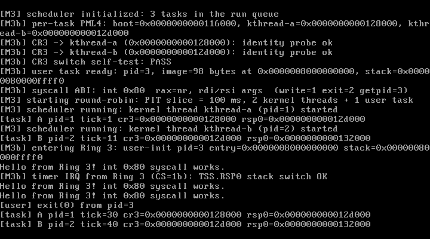

# M3b Step 2 — Ring 3、iretq 与 int 0x80 系统调用

> 状态：**M3b-2 已完成并通过实测**（QEMU 10.2.1 + VirtualBox 7.2.16）  
> 日期：2026-10-27  
> 关联文档：[M3b-paging.md](./M3b-paging.md) · [design.md](./design.md)

---

## 1. 本步目标

从 Ring 0 跨越到 Ring 3，并建立第一版自定义系统调用：

1. GDT 增加 DPL 3 的用户代码/数据段，TSS 移到 `0x28`；
2. 用户地址空间放在 **PML4[1]（512 GiB）**，与内核低 1 GiB 恒等映射分离；
3. 写 `paging_map_user()`：PML4/PDPT/PD/PT 各级都设置 U/S 位；
4. `user_enter()` 构造 iretq 帧（SS/RSP/RFLAGS/CS/RIP），从 Ring 0 掉到 Ring 3；
5. `int 0x80` 作为 syscall 入口，IDT 门 DPL=3；
6. 自定义 syscall ABI：`write`、`exit`、`getpid`；
7. 用户程序以平坦二进制形式嵌入内核，启动时映射到用户空间；
8. 验证 **Ring 3 运行期间 PIT 中断**能通过 TSS.RSP0 正确切到该任务内核栈。

---

## 2. 交付物

| 文件 | 作用 |
| --- | --- |
| `include/x86_64/gdt.h` / `arch/x86_64/gdt.c` | GDT 改为 7 槽：kcode/kdata/**ucode(0x18)/udata(0x20)**/TSS(0x28)，`ltr 0x28` |
| `include/x86_64/paging.h` / `arch/x86_64/paging.c` | 新增 `paging_map_user()`：逐级分配页表并设置 U/S 位 |
| `include/x86_64/usermode.h` | `USER_BASE=0x0000008000000000`、`USER_STACK_TOP`、`user_enter()` |
| `arch/x86_64/usermode.S` | iretq 帧 + 用户段选择子（`0x1B`/`0x23`） |
| `include/task.h` / `sched/scheduler.c` | `task` 增加 user 字段；`task_create_user()` 映射用户代码/栈；`task_bootstrap` 进入 Ring 3 |
| `include/syscall.h` / `syscall/syscall.c` | 自定义 syscall 分发：write/exit/getpid |
| `arch/x86_64/idt.c` | `int 0x80` 门（DPL 3，flags `0xEE`）与 syscall 分派 |
| `arch/x86_64/isr_asm.S` | 新增 `isr128` 中断桩 |
| `arch/x86_64/irq.c` | 首次从 Ring 3 收到定时器中断时打印验证标记 |
| `user/init.S` / `user/user.ld` | 用户态测试程序与链接脚本（0x8000000000） |
| `Makefile` | 用户程序 ELF→flat binary→`ld -r -b binary` 嵌入内核；M3b 测试判定 |
| `docs/m3b2-vbox.png` | VirtualBox 实测截图 |

---

## 3. 设计

### 3.1 地址空间布局

| 区域 | 虚拟地址 | 权限 |
| --- | --- | --- |
| 内核恒等映射（代码/栈/堆/页表） | `0x0000_0000_0000_0000` – `0x0000_0000_3FFF_FFFF`（低 1 GiB） | P/W，**U/S = 0** |
| 用户代码（flat binary） | `0x0000_0080_0000_0000`（512 GiB） | P/W/**U** |
| 用户栈 | `0x0000_0080_000F_ F000` – `0x0000_0080_0010_0000` | P/W/**U** |

- 用户映射使用 **PML4[1]**，避免与内核恒等映射所在的 PML4[0] 冲突；
- `paging_map_user()` 在每一级都强制 `U/S=1`，否则 Ring 3 访问会立刻 `#PF`；
- 内核仍位于低地址且 U/S=0，用户态无法读写内核。

### 3.2 GDT 布局

| 选择子 | 描述 | DPL |
| --- | --- | --- |
| `0x00` | null | – |
| `0x08` | 内核代码 | 0 |
| `0x10` | 内核数据 | 0 |
| `0x18` | **用户代码 → `0x1B`** | 3 |
| `0x20` | **用户数据 → `0x23`** | 3 |
| `0x28` | TSS（占 `0x28/0x30` 两槽） | 0 |

`gdt_init()` 先 `lgdt`，重载内核数据段，然后 `ltr 0x28`。TSS.RSP0 由调度器在每次任务切换时更新。

### 3.3 从 Ring 0 掉到 Ring 3：伪造 iretq 帧

`user_enter(entry, user_stack_top)` 的汇编核心：

```asm
cli
pushq $0x23        /* SS  = user data | RPL 3 */
pushq %rsi         /* RSP = user stack top */
pushq $0x202       /* RFLAGS: IF = 1 */
pushq $0x1B        /* CS  = user code | RPL 3 */
pushq %rdi         /* RIP = user entry */
movw $0x23, %ax
movw %ax, %ds
movw %ax, %es
movw %ax, %fs
movw %ax, %gs
iretq
```

- DS/ES/FS/GS 在 Ring 0 内先换成用户数据段（数值上合法），**SS 不换**，由 `iretq` 原子切换到 0x23；
- RFLAGS 的 `IF=1`，所以用户程序一进入就可被 PIT 抢占；
- 该路径的关键前提是 TSS.RSP0 已指向当前任务内核栈顶（M3b-1 已完成）。

### 3.4 自定义 syscall ABI（与 Linux 无关）

| 项 | 约定 |
| --- | --- |
| 入口 | `int 0x80`（IDT 门 DPL=3，flags `0xEE`） |
| 调用号 | `rax`（1 = write，2 = exit，3 = getpid） |
| 参数 | `rdi`、`rsi`、`rdx` |
| 返回值 | 写回中断帧的 `rax`；错误为 `(u64)-1` |
| 用户指针 | 必须是 `[USER_BASE, USER_STACK_TOP)` 范围内的用户映射；越界直接返回 -1 |
| 实现 | 复用 `registers_t` 中断帧，不做额外寄存器搬运 |

- `write(ptr, len)`：内核逐字节 `kputc` 输出（后续会改为 copyin/copyout + fd 表）；
- `exit(status)`：打印退出信息，把任务标记为 `TASK_DEAD`，调用 `schedule()` 永不返回；
- `getpid()`：返回当前任务 PID。

### 3.5 用户程序构建流程

```
user/init.S  --as-->  user/init.o
             --ld -T user/user.ld-->  user/init.elf   (链接到 0x8000000000)
             --objcopy -O binary-->  user/init.bin    (98 字节)
             --ld -r -b binary-->    user_init_blob.o
             --ld (kernel)-->        _binary_user_init_bin_start/_end
```

`task_create_user()` 把 blob 逐页复制到 PMM 分配的物理页，映射到 `USER_BASE`，再映射一页用户栈；创建任务后由 `task_bootstrap()` 调用 `user_enter()`。

### 3.6 Ring 3 中断与 TSS.RSP0

用户态程序里的延时循环让 CPU 在 Ring 3 停留超过若干个 PIT tick。第一次从 Ring 3 收到 IRQ0 时，`irq_handler()` 打印：

```
[M3b] timer IRQ from Ring 3 (CS=1b): TSS.RSP0 stack switch OK
```

这直接证明：

1. CPU 在 CPL=3 时收到中断，使用 TSS.RSP0 切换到该任务的内核栈；
2. 中断桩/调度器/iretq 返回用户态整条链路正确；
3. 调度器可以在用户任务与内核线程之间抢占切换（日志中 A/B 行穿插在用户程序输出之间）。

---

## 4. 实测记录（2026-10-27）

### 4.1 QEMU：`make test` → PASS

```
[M3b] per-task PML4: boot=0x116000, kthread-a=0x128000, kthread-b=0x12d000
[M3b] CR3 switch self-test: PASS
[M3b] user task ready: pid=3, image=98 bytes at 0x0000008000000000, stack=0x00000080000ffff0
[M3b] syscall ABI: int 0x80  rax=nr, rdi/rsi args  (write=1 exit=2 getpid=3)
[M3] starting round-robin: PIT slice = 100 ms, 2 kernel threads + 1 user task
[M3b] entering Ring 3: user-init pid=3 entry=0x0000008000000000 stack=0x00000080000ffff0
Hello from Ring 3! int 0x80 syscall works.
[M3b] timer IRQ from Ring 3 (CS=1b): TSS.RSP0 stack switch OK
[task] A pid=1 tick=40 cr3=0x128000 rsp0=0x12d000
[task] B pid=2 tick=50 cr3=0x12d000 rsp0=0x132000
Hello from Ring 3! int 0x80 syscall works.
...
[user] exit(0) from pid=3
```

- 用户程序打印 3 行并正常 `exit(0)`；
- 期间发生 Ring 3 → Ring 0 的 PIT 中断，A/B 内核线程被调度执行，随后用户任务恢复并继续；
- `make test`：**PASS**（task A/B 各 48 行，Ring 3 + syscall 校验通过）。

### 4.2 异常回归

`make test-exception` → **PASS**（故意 `#PF` 仍然打印现场并 PANIC）。

### 4.3 VirtualBox 7.2.16

临时 BIOS 虚拟机（512 MB、IDE CD、COM1→文件）启动同一 ISO：

- 串口日志包含 Ring 3 输出、`timer IRQ from Ring 3 (CS=1b)`、`[user] exit(0)`；
- VGA 截图见下（同一时刻的完整启动链 + Ring 3 + 内核线程）。



---

## 5. 关键点与踩坑

| 问题 | 后果 | 解决 |
| --- | --- | --- |
| 用户页表任一级漏设 U/S | Ring 3 访问立刻 `#PF` | `paging_map_user()` 对每一级强制 `PTE_USER` |
| 用户空间放低地址 | 与内核恒等映射冲突（替换 PML4[0] 后内核代码/栈不可见） | 用户映射放 PML4[1]（512 GiB） |
| GDT 没有 DPL3 段 | `iretq` 到 `0x1B/0x23` 触发 `#GP` | GDT 重排：ucode 0x18 / udata 0x20 / TSS 0x28 |
| `int 0x80` 门 DPL=0 | Ring 3 执行 `int 0x80` 触发 `#GP` | IDT 0x80 使用 flags `0xEE` |
| TSS.RSP0 未 per-task | 用户态中断会使用错误内核栈，直接崩溃 | 调度器每次切换写入 `next->kernel_stack + stack_size` |
| 用户指针直接解引用 | 恶意地址可打穿内核 | 先做用户范围校验；后续引入 copyin/copyout + SMAP |
| exit 返回用户态 | 任务状态/栈已失效 | `exit` 标记 DEAD 后 `schedule()` 永不返回，调度器跳过 DEAD |
| 用户二进制链接地址 | 平坦二进制必须按用户虚拟地址链接 | `user/user.ld` 固定 `. = 0x8000000000`，`objcopy -O binary` 后嵌入 |

---

## 6. 已知限制

1. 只有一个硬编码的用户任务（`user-init`），没有通用 `exec`/ELF 加载器；
2. 用户任务退出后不回收 PML4/用户页（泄漏，等进程生命周期管理）；
3. syscall 只有 write/exit/getpid；没有 `read`、`fork`、`wait`、文件系统相关调用；
4. 用户指针只用范围校验，未做 `copyin/copyout`、未启用 SMAP；
5. 用户栈只有 1 页且无 guard page；
6. 没有优先级/时间片配额；DEAD 任务仍留在环形链表里（调度时跳过）；
7. 内核仍恒等映射低 1 GiB（PML4[0]），用户空间只能放 PML4[1]；
8. 双故障仍未配置 IST1（下一步补）。

---

## 7. 下一步

1. **进程生命周期**：用户进程创建/退出/回收、`wait`、退出码传递、用户页释放；
2. **copyin/copyout + SMAP**，替换范围校验；
3. 更多 syscall：`read`、`yield`、`sleep`、`open/close`（配合 M4 VFS）；
4. 极简 ELF 加载器（替代嵌入的 flat binary）；
5. 优先级/更完整的调度策略；
6. IST1（双故障专用栈）与更完善的 panic 回溯。

---

## 8. 复现清单

- [x] GDT 用户段（0x18/0x20）+ TSS 移到 0x28
- [x] 用户空间位于 PML4[1]，各级 U/S=1
- [x] `user_enter()` iretq 进入 CPL 3
- [x] `int 0x80` DPL=3 + 自定义 syscall（write/exit/getpid）
- [x] 用户程序打印 3 行并 `exit(0)`
- [x] Ring 3 期间 PIT 中断 → TSS.RSP0 切栈成功（日志标记）
- [x] QEMU `make test` PASS（A/B 48 行 + Ring 3 校验）
- [x] `make test-exception` 回归 PASS
- [x] VirtualBox 7.2.16 实测（串口 + 截图）
- [x] 多目录构建零警告
