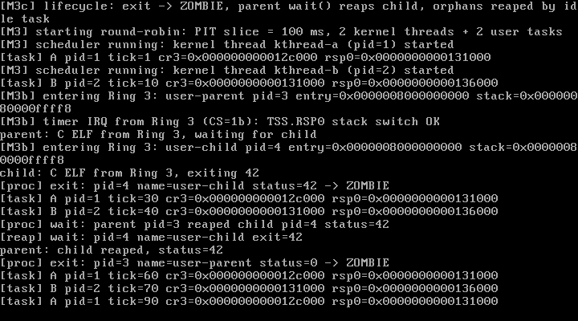

# M3c Step 2 — 通用 ELF64 加载器与 C 用户程序

> 状态：**M3c-2 已完成并通过实测**（QEMU 10.2.1 + VirtualBox 7.2.16）  
> 日期：2026-10-28  
> 关联文档：[M3c-lifecycle.md](./M3c-lifecycle.md) · [design.md](./design.md)

---

## 1. 本步目标

1. 写一个真正的 **ELF64 用户程序加载器**，替代 `ld -r -b binary` 的 flat binary；
2. 解析 `Elf64_Ehdr` / `Elf64_Phdr`，只加载 `PT_LOAD`；
3. **按页处理段**：两个 PT_LOAD 共用一个物理页时不能互相覆盖；
4. 正确清零 `.bss`（`p_memsz > p_filesz`）；
5. 用 `e_entry` 作为用户 RIP；
6. 用户程序改用 **C 语言 + userlib.h**，为后续开发提速；
7. 加载失败时回滚，释放已建立的用户页表，避免泄漏。

---

## 2. 交付物

| 文件 | 作用 |
| --- | --- |
| `include/elf.h` | 自研 `Elf64_Ehdr` / `Elf64_Phdr` 定义与 `elf_load_user()` 接口 |
| `mm/elf.c` | 三遍扫描的页级 ELF 加载器 |
| `include/x86_64/paging.h` / `arch/x86_64/paging.c` | 新增 `paging_ensure_user_page()`：按需分配/复用用户物理页 |
| `include/task.h` / `sched/scheduler.c` | `task_create_user_elf()`：加载 ELF → 映射用户栈 → 建任务；失败时销毁地址空间 |
| `kernel.c` | ELF 自检日志 + 从 ELF 创建 parent/child 两个用户任务 |
| `user/userlib.h` | `int 0x80` 的 C 内联封装：`write` / `exit` / `wait` |
| `user/parent.c` / `user/child.c` | C 语言 Ring 3 程序（替代原有 `.S`） |
| `user/user.ld` | 用 `PHDRS` **强制两个 PT_LOAD 段共享第一页**（专测页重叠） |
| `Makefile` | C→ELF64→嵌入；`-mcmodel=large` 等用户编译参数 |
| `docs/m3c2-vbox.png` | VirtualBox 实测截图 |

`user/parent.S`、`user/child.S` 已退役。

---

## 3. ELF 加载器设计

### 3.1 校验

严格检查：

- `e_ident` magic、`ELFCLASS64`、`ELFDATA2LSB`；
- `e_machine == EM_X86_64`、`e_type == ET_EXEC/ET_DYN`；
- `e_phentsize == sizeof(Elf64_Phdr)`、`phnum <= 32`、`phoff + phnum*phentsize <= size`；
- `e_entry` 落在用户地址范围；
- 每个 `PT_LOAD`：`filesz <= memsz`、`offset+filesz <= size`、`vaddr >= USER_BASE`、`vaddr+memsz` 不越界（且不占用用户栈顶页）。

### 3.2 三遍扫描（关键）

```
Pass 1: 校验所有 PT_LOAD，并为覆盖到的每一页调用 paging_ensure_user_page()
Pass 2: 对每个段 [vaddr+filesz, vaddr+memsz) 做按页清零（.bss）
Pass 3: 按页拷贝 [vaddr, vaddr+filesz) 的文件数据
```

**为什么拷贝放最后**：如果两个段共享同一页，BSS 清零可能触及另一段的文件数据区；最后执行文件拷贝可以保证"文件数据优先"，不会被清零覆盖。

页内计算完全使用"页对齐后的地址 + 交集"：

```c
page_start = ALIGN_DOWN(p_vaddr);
page_end   = ALIGN_UP(p_vaddr + p_memsz);
for (page...) {
    phys = paging_ensure_user_page(pml4, page);   /* 同页复用同一个物理页 */
    copy/zero 只在 [page, page+PAGE_SIZE) 与段范围的交集内进行
}
```

`paging_ensure_user_page()` 会逐级建立 PML4/PDPT/PD/PT，且每一级都设置 U/S。

### 3.3 加载失败回滚

`task_create_user_elf()` 在 `elf_load_user()` 失败时调用 `paging_destroy_user_space(pml4)`，释放已分配的叶子页、页表页和 PML4，然后 panic 报告——不会泄漏内存。

### 3.4 用户栈

用户栈仍然是一页，映射在 `USER_STACK_TOP - PAGE_SIZE`；初始 RSP 设为 `USER_STACK_TOP - 8`，满足 SysV ABI 对函数入口 `rsp % 16 == 8` 的约定，C 编译出的 `_start` 可以安全使用栈。

### 3.5 专门制造"页重叠"测试

`user/user.ld` 用 `PHDRS` 强制生成两个 LOAD 段：

```
LOAD #1  RX  vaddr = 0x8000000000  (.text/.rodata)
LOAD #2  RW  vaddr = 0x8000000900  (.data/.bss)   <- 非页对齐，与 #1 同页
```

实际 `readelf -l`：

```
LOAD 0x1000 0x8000000000 filesz=322 memsz=322  R E
LOAD 0x1900 0x8000000900 filesz=8   memsz=16   RW
```

内核自检日志：

```
[elf] entry=0x0000008000000000 phnum=2 phoff=64
[elf] PT_LOAD vaddr=0x0000008000000000 off=4096 filesz=322 memsz=322
[elf] PT_LOAD vaddr=0x0000008000000900 off=6400 filesz=8   memsz=16
```

两个段都在第 0 页内。若按"段级 memcpy/清零"实现，`.data` 或 `.text` 必被覆盖；页级实现则完全正确。用户程序内还加了 `.data` 与 `.bss` 自检：

- parent：`g_parent_data == 0x12345678`；
- child：`g_child_data == 0x0BADF00D` 且 `g_child_bss == 0`。

串口日志中没有 `FAILED`，说明两个段的数据都完好。

### 3.6 C 用户程序与编译参数

```make
USER_CFLAGS := -m64 -std=gnu11 -ffreestanding -fno-pie -fno-pic \
               -mcmodel=large -fno-stack-protector -fno-builtin \
               -fno-asynchronous-unwind-tables -mgeneral-regs-only \
               -nostdinc -Iuser -O2 -g -Wall -Wextra
```

- **必须 `-mcmodel=large`**：用户程序链接在 `0x0000008000000000`（512 GiB），x86_64 默认 small code model 生成 32 位绝对重定位，`ld` 会报 `relocation truncated to fit: R_X86_64_32`；
- `--no-warn-rwx-segments`：故意让两段共享一页会产生权限重叠的 LOAD 段，链接器会警告，这里显式关闭该提示；
- `userlib.h` 用内联汇编封装 syscall，完全不依赖 libc。

---

## 4. 实测记录（2026-10-28）

### 4.1 QEMU：`make test` → PASS

```
[M3c2] ELF loader self-check: embedded ELF64 user images:
[elf] entry=0x0000008000000000 phnum=2 phoff=64
[elf] PT_LOAD vaddr=0x0000008000000000 off=4096 filesz=322 memsz=322
[elf] PT_LOAD vaddr=0x0000008000000900 off=6400 filesz=8 memsz=16
[M3c2] ELF tasks: parent pid=3 entry=0x8000000000, child pid=4 entry=0x8000000000
parent: C ELF from Ring 3, waiting for child
child: C ELF from Ring 3, exiting 42
[M3b] timer IRQ from Ring 3 (CS=1b): TSS.RSP0 stack switch OK
[proc] exit: pid=4 name=user-child status=42 -> ZOMBIE
[proc] wait: parent pid=3 reaped child pid=4 status=42
[reap] wait: pid=4 name=user-child exit=42
[reap] orphan: pid=3 name=user-parent exit=0
```

- 两个 C ELF 正常进入 Ring 3；
- `.data/.bss` 校验通过；
- child `exit(42)` → 僵尸 → parent `wait()` 取回 42 并回收；
- parent 退出后孤儿被空闲回收器释放；
- A/B 内核线程继续运行（最终 A=45、B=45）。

### 4.2 异常回归

`make test-exception` → **PASS**。

### 4.3 VirtualBox 7.2.16

同一 ISO 在临时 BIOS 虚拟机中启动，串口完整打印 ELF 段信息与生命周期；VGA 截图见下。



---

## 5. 踩坑记录

| 问题 | 现象 | 解决 |
| --- | --- | --- |
| 高地址用户程序的绝对重定位 | `ld: relocation truncated to fit: R_X86_64_32` | 用户程序加 `-mcmodel=large` |
| 链接器合并 .data 到 RWE 段 | 无法测试页重叠 | 用 `PHDRS` 强制两个 LOAD 段、`data` 段非页对齐 |
| 两个段同页 | 段级 memcpy/清零会互相覆盖 | 三遍扫描 + 页级交集；文件数据最后拷贝 |
| BSS 未清零 | C 全局变量初值随机 | Pass 2 按 `p_memsz > p_filesz` 范围清零 |
| 用户栈 ABI 对齐 | C `_start` 栈错位 | 初始 RSP = `USER_STACK_TOP - 8` |
| 加载失败泄漏 | 半初始化页表残留 | 失败即 `paging_destroy_user_space()` |
| `wait(&status)` 类型 | 内核写 8 字节，用户 `int` 只有 4 字节 | 用户侧使用 `long status` |

---

## 6. 已知限制

1. 只接受简单 `ET_EXEC/ET_DYN`，**不支持 PT_INTERP / 动态链接 / 重定位**；
2. 忽略 `p_align` 和段权限 `p_flags`：所有用户页统一 `P|W|U`（RWX），尚未实现 NX / 只读代码段；
3. 加载是**全量 eager mapping**，没有按需分页；
4. 用户栈仍只有 1 页、无 guard page；
5. 没有 argv/envp/auxv，`e_entry` 直接以空参数启动；
6. 没有 ELF 段校验和 / 签名（M3c 阶段不做安全启动）；
7. copyin/copyout + SMAP 仍未实现（下一个 M3c-3）。

---

## 7. 下一步（M3c-3 及之后）

### M3c-3：用户内存安全

- `copy_from_user()` / `copy_to_user()`：`stac` / `clac` 包住访问；
- 页错误 **fixup 表**：copy 期间 `#PF` 跳到恢复点返回 `-EFAULT`，而不是 panic；
- 开启 CR4.SMAP，验证内核不能直接解引用用户指针；
- 用户态 syscall 参数全部走 copyin/copyout。

### 之后可做

- 按 `p_flags` 设置页面权限（只读代码段 + NX）；
- 按需分页 / demand paging；
- ELF `argv/envp` 与 `_start(argc, argv, envp)` 约定；
- 进程创建 API（spawn/exec），替换内核里硬编码的 parent/child；
- 进入 M4 VFS。

---

## 8. 复现清单

- [x] ELF magic/class/machine/type/header 校验
- [x] PT_LOAD 三段式页级加载（map → zero BSS → copy file data）
- [x] 两个 PT_LOAD 共享同一页且 `.data/.bss` 校验通过
- [x] `e_entry` 作为用户 RIP；用户栈 ABI 对齐
- [x] 失败回滚 `paging_destroy_user_space()`
- [x] C 用户程序 + `userlib.h`（no libc）
- [x] QEMU `make test` PASS（A/B 45/45，ELF + 生命周期）
- [x] `make test-exception` 回归 PASS
- [x] VirtualBox 7.2.16 实测（串口 + 截图）
- [x] 构建零警告
