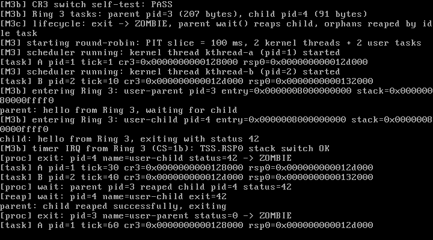

# M3c Step 1 — 进程生命周期：exit / wait / 僵尸回收

> 状态：**M3c-1 已完成并通过实测**（QEMU 10.2.1 + VirtualBox 7.2.16）  
> 日期：2026-10-28  
> 关联文档：[M3b-ring3-syscall.md](./M3b-ring3-syscall.md) · [design.md](./design.md)

---

## 1. 本步目标

让用户进程"能正常结束且不留下垃圾"：

1. `sys_exit(code)` 不再直接销毁任务，而是转为 **ZOMBIE** 并保存退出码；
2. 父进程 `sys_wait(&status)` 等待子进程、取回退出码，并**回收**子进程资源；
3. 没有父进程的僵尸（孤儿）由**空闲任务定期回收**；
4. 资源回收覆盖：用户页、PML4、中间页表页、内核栈、task 结构；
5. 保持 Ring 3、syscall、RR 调度和 A/B 内核线程继续正常工作。

**不在本步**：ELF 加载器、copyin/copyout、SMAP、`waitpid(-1)` 语义、进程树 reparent（下一步 M3c-2/3）。

---

## 2. 交付物

| 文件 | 变化 |
| --- | --- |
| `include/task.h` | 新增 `TASK_WAITING` / `TASK_ZOMBIE`、`parent`、`exit_code`，以及生命周期 API |
| `sched/scheduler.c` | `task_find_zombie_child()`、`task_has_children()`、`task_reap()`、`task_reap_orphans()`；调度器跳过 WAITING/ZOMBIE |
| `include/x86_64/paging.h` / `arch/x86_64/paging.c` | 新增 `paging_destroy_user_space()`：释放 PML4[1] 下的叶子页 + 各级页表页 + PML4 |
| `include/syscall.h` / `syscall/syscall.c` | `SYS_WAIT`；`SYS_EXIT` 改为僵尸化并唤醒等待父进程 |
| `kernel.c` | 创建 parent/child 两个 Ring 3 任务（建立父子关系）；空闲循环定期调用孤儿回收器 |
| `user/parent.S` / `user/child.S` | parent：write → wait → 打印成功 → exit(0)；child：write → Ring 3 延时 → exit(42) |
| `Makefile` | 两个用户程序 → `user_blobs.o`（`ld -r -b binary`）；M3c 测试判定 |
| `.gitignore` | `user/*.bin` 不再入库 |
| `docs/m3c1-vbox.png` | VirtualBox 实测截图 |

旧的 `user/init.S` 已退役（被 parent/child 取代）。

---

## 3. 设计

### 3.1 任务状态机

```
                 create
                   |
                   v
   +-----------> READY <----------+
   |              |               |
   |         scheduler            | child exit wakes waiting parent
   |              v               |
   |           RUNNING ---exit---> ZOMBIE
   |              |                 |
   |           wait()                | parent wait()/reaper
   |              v                 v
   +---------- WAITING           (freed)
```

- `TASK_WAITING`：父进程在 `wait()` 中阻塞，调度器跳过；
- `TASK_ZOMBIE`：已退出但资源尚未回收；仍留在环形链表里，调度器跳过；
- `TASK_DEAD`：保留给内核线程异常退出的兜底状态。

### 3.2 sys_exit：只僵尸化，绝不释放当前栈

```c
t->exit_code = status;
t->state = TASK_ZOMBIE;
if (t->parent && t->parent->state == TASK_WAITING)
    t->parent->state = TASK_READY;   /* 唤醒父进程 */
for (;;) schedule();                 /* 永不返回用户态 */
```

**关键点**：exit 仍在当前任务的内核栈上执行，所以绝不能在这里释放内核栈/页表；只做状态转换，资源交给父进程或回收器在新上下文中释放（正是你之前提醒的坑）。

### 3.3 sys_wait：阻塞等待 + 回收

```c
for (;;) {
    child = task_find_zombie_child(self);
    if (child) {
        *status_ptr = child->exit_code;
        task_reap(child, "wait");    /* 安全：不在子任务上下文 */
        return child->pid;
    }
    if (!task_has_children(self))
        return -1;
    self->state = TASK_WAITING;
    schedule();                      /* 等子进程 exit 唤醒 */
}
```

- 子进程先退出也没关系：父进程进入 wait 时直接找到 ZOMBIE；
- 父进程阻塞期间，PIT 仍可调度 A/B 内核线程与另一个用户进程；
- 子进程 exit 时把父进程置为 READY，父进程恢复后完成回收。

### 3.4 资源回收：paging_destroy_user_space()

只回收 **PML4[1]（用户空间）** 所属的页，绝不碰 PML4[0] 的内核恒等映射：

```c
PML4[1] -> PDPT -> PD -> PT -> 4 KiB user pages
   逐级：
     - 释放 PT 中的叶子页（代码页/用户栈页）
     - 释放 PT、PD、PDPT 页本身
     - 最后释放 PML4 页
```

随后 `pmm_free_pages(kernel_stack, 4)`，再 `kfree(task)`。回收顺序必须是先"从运行队列摘除"，再释放资源。

### 3.5 孤儿回收器

父进程退出后它自己成为孤儿 ZOMBIE（`parent == NULL`）。内核让 **boot 空闲任务**每 100 tick（约 1 秒）执行一次：

```c
task_reap_orphans();   /* 内部 cli，扫描并释放 parent == NULL 的 ZOMBIE */
```

- 回收器运行在空闲任务上下文，不在僵尸自己的栈上，因此可以安全释放僵尸的内核栈；
- 被回收任务的子任务会被置 `parent = NULL`，下次扫描继续回收（级联孤儿）；
- 单 CPU 下用关中断保护链表操作。

### 3.6 测试用的父子进程

- `user/parent.S`：write 问候 → `wait(&status)` → 成功则打印 → `exit(0)`；
- `user/child.S`：write 问候 → 约 30M 次 Ring 3 延时（跨 PIT tick，继续验证用户态中断）→ `exit(42)`；
- 内核创建顺序：parent 先入队、child 后入队，并设置 `child->parent = parent`。

---

## 4. 实测记录（2026-10-28）

### 4.1 QEMU：`make test` → PASS

```
[M3b] Ring 3 tasks: parent pid=3 (207 bytes), child pid=4 (91 bytes)
[M3c] lifecycle: exit -> ZOMBIE, parent wait() reaps child, orphans reaped by idle task
...
[M3b] entering Ring 3: user-parent pid=3 ...
parent: hello from Ring 3, waiting for child
[M3b] entering Ring 3: user-child pid=4 ...
child: hello from Ring 3, exiting with status 42
[M3b] timer IRQ from Ring 3 (CS=1b): TSS.RSP0 stack switch OK
[proc] exit: pid=4 name=user-child status=42 -> ZOMBIE
[tick] uptime=1 s ticks=100
[proc] wait: parent pid=3 reaped child pid=4 status=42
[reap] wait: pid=4 name=user-child exit=42
parent: child reaped successfully, exiting
[proc] exit: pid=3 name=user-parent status=0 -> ZOMBIE
...
[reap] orphan: pid=3 name=user-parent exit=0
```

- `[proc] exit` 证明 exit 只进入 ZOMBIE；
- `[proc] wait ... status=42` 证明父进程取到退出码并回收子进程；
- `[reap] wait` 证明子进程的用户页/PML4/内核栈被释放；
- `[reap] orphan` 证明父进程退出后由空闲回收器清理；
- 期间 A/B 内核线程持续输出（最终 A=49、B=49 行），系统无崩溃。

### 4.2 异常回归

`make test-exception` → **PASS**（`#PF` 现场 + PANIC 仍正常）。

### 4.3 VirtualBox 7.2.16

同一 ISO 在临时 BIOS 虚拟机（512 MB、COM1→文件）中启动，串口日志完整复现上述生命周期；VGA 截图见下。



---

## 5. 踩坑与设计要点

| 问题 | 后果 | 处理 |
| --- | --- | --- |
| 在 exit 中释放当前内核栈 | 立刻崩溃（还在用这块栈） | exit 只设置 ZOMBIE，资源由 wait/回收器释放 |
| 先释放资源再摘链 | 调度器可能访问已释放 task | 先 `unlink`，再释放 PML4/栈/结构体 |
| wait 直接忙等 | 浪费 CPU/无法让子进程运行 | 父进程置 `TASK_WAITING` 后 `schedule()`，child exit 唤醒 |
| 只释放叶子页 | 页表页与 PML4 泄漏 | `paging_destroy_user_space()` 逐级释放 |
| 回收时碰 PML4[0] | 破坏内核恒等映射 | 只处理 PML4[1] 用户子树 |
| 孤儿无人回收 | 父进程退出后遗留 ZOMBIE | boot 空闲任务定期 `task_reap_orphans()` |
| 用户程序状态传递 | 无法验证退出码 | wait 把 `exit_code` 写到用户提供的 `&status` |
| 编译警告 | `user/*.S` 注释写法触发 `-Wcomment` | 改为 `user/ parent.S and child.S` |

---

## 6. 已知限制

1. `wait()` 只支持"父等直接子进程"，没有 `waitpid(pid)` / `waitpid(-1)` 语义；
2. 没有真正的 reparent 到 init：孤儿统一由空闲回收器处理，父进程看不到子进程的"被收养"关系；
3. 没有进程组/会话、信号、`kill`；
4. 仍有 M3b-2 的安全短板：用户指针只做范围校验，无 `copyin/copyout`，未启用 SMAP；
5. 没有 ELF 加载器，用户程序仍是内嵌 flat binary；
6. 用户栈只有 1 页且无 guard page；
7. 僵尸的退出状态只能被父进程取一次，没有 `WNOHANG`。

---

## 7. 下一步（M3c-2 / M3c-3）

### M3c-2：ELF 加载器

- 解析 `Elf64_Ehdr` / `Elf64_Phdr`；
- 对每个 `PT_LOAD`：按页分配、按 `p_offset` 拷贝、`p_memsz > p_filesz` 部分清零（.bss）；
- **按页处理段重叠**（你提醒的关键点：不要整块 memcpy，段可能共享同一页）；
- `e_entry` 作为用户 RIP；用户栈映射仍用 `USER_STACK_TOP`；
- 清理：加载失败时释放已映射页。

### M3c-3：copyin/copyout + SMAP

- `copy_from_user()` / `copy_to_user()` 走 `stac`/`clac`；
- 页错误处理加入 **fixup 表**（类似 `setjmp/longjmp` 思想）：在 copy 期间发生 `#PF` 时跳到恢复点返回 `-EFAULT`，而不是 panic；
- 开启 CR4.SMAP 后，所有用户指针访问必须经过 copyin/copyout；
- 需要和当前"异常即 panic"的 `idt.c` 解耦，加入 per-task/失败点恢复机制。

之后进入 M4 VFS（文件描述符、ramfs、init/shell）。

---

## 8. 复现清单

- [x] `TASK_WAITING` / `TASK_ZOMBIE` 状态机
- [x] `sys_exit` 僵尸化 + 唤醒等待父进程
- [x] `sys_wait` 阻塞等待、取退出码、回收子进程
- [x] `paging_destroy_user_space()` 释放用户页/页表/PML4
- [x] 空闲任务孤儿回收（`[reap] orphan`）
- [x] parent/child 两个 Ring 3 用户程序
- [x] QEMU `make test` PASS（A/B 49/49，生命周期校验）
- [x] `make test-exception` 回归 PASS
- [x] VirtualBox 7.2.16 实测（串口 + 截图）
- [x] 构建零警告
