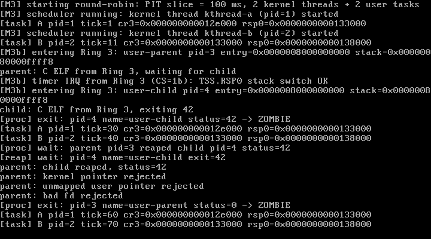

# M4 Step 1 — file 对象、每任务 fd 表与 console 字符设备

> 状态：**M4-1 已完成并通过实测**（QEMU 10.2.1 + VirtualBox 7.2.16）  
> 日期：2026-10-28  
> 关联文档：[design.md](./design.md) · [M3c-uaccess.md](./M3c-uaccess.md)

---

## 1. 本步目标

给内核加上"文件"这一层抽象，但先不引入 inode/dentry/superblock：

1. 自研 `struct file` / `struct file_operations`；
2. 每个任务拥有独立的 **fd 表**（`fd_table[32]`）；
3. 第一个字符设备：**console**，作为 fd 0/1/2 的后端；
4. 用户态 `write(fd, buf, count)` 从"直接 kprintf"改为 **查 fd 表 → 调 `f_op->write`**；
5. 任务退出/reap 时遍历 fd 表关闭全部 file，避免 fd 泄漏；
6. 非法 fd、非法指针都被安全拒绝。

> 结构设计全部自研，借鉴的是公开的 "file operations + fd table" 概念，不复制 Linux 的 `struct file` / `file_operations` 布局或 syscall ABI。

---

## 2. 交付物

| 文件 | 作用 |
| --- | --- |
| `include/fs.h` | `file_operations`、`file`、fd 常量与 per-task fd 操作接口 |
| `fs/file.c` | file 分配/引用计数、fd 安装/查找/关闭、stdin/stdout/stderr 安装、任务退出清理 |
| `include/console.h` / `drivers/console.c` | console 字符设备：`write` 走 kputc；`read` 暂未实现 |
| `include/errno.h` | 自定义错误码（`EBADF`、`EFAULT`、`EINVAL`、`ENOSYS`） |
| `include/task.h` | 任务内新增 `struct file *fd_table[MAX_FDS]` |
| `sched/scheduler.c` | 任务创建时安装 fd 0/1/2；reap 时 `task_fd_close_all()` |
| `syscall/syscall.c` | `write(fd, buf, count)`：copyin + `file->f_op->write`；错误码返回 |
| `user/userlib.h` | `sys_write(fd, buf, len)` 新 ABI |
| `user/parent.c` | 经 fd 1 输出；新增 bad fd 测试 |
| `Makefile` | 新源文件；M4-1 测试判定 |
| `docs/m4a-vbox.png` | VirtualBox 实测截图 |

---

## 3. 设计

### 3.1 file 与 file_operations（自研）

```c
struct file_operations {
    i64 (*read)(struct file *file, void *buf, u64 count);
    i64 (*write)(struct file *file, const void *buf, u64 count);
    i64 (*ioctl)(struct file *file, u32 cmd, u64 arg);
};

struct file {
    const struct file_operations *f_op;
    void *private_data;     /* 具体设备/文件系统对象 */
    u64 f_pos;              /* 当前偏移，后续 ramfs 使用 */
    u32 f_flags;            /* O_RDONLY / O_WRONLY / O_RDWR */
    u32 refcount;           /* 从 1 开始；close 时递减到 0 才释放 */
};
```

- `file_alloc()` 从 kmalloc 分配，引用计数 = 1；
- `file_close()` 递减引用计数，归零才 `kfree`，为未来 `dup`/共享 file 留好路。

### 3.2 每任务 fd 表

```c
#define MAX_FDS 32
struct task {
    ...
    struct file *fd_table[MAX_FDS];
};
```

- 内核线程 / boot 任务的 fd 表全为 NULL；
- Ring 3 任务创建时 `task_setup_std_fds()` 安装 3 个**独立** file 对象：
  - fd 0 → stdin（console，O_RDONLY）
  - fd 1 → stdout（console，O_WRONLY）
  - fd 2 → stderr（console，O_WRONLY）
- 每个 fd 拥有独立 file 与引用计数，避免多个进程共享同一个 `f_pos`/flag；
- `task_reap()` 在释放资源前调用 `task_fd_close_all()`，遍历 32 个槽位关闭 file，**不会 fd 泄漏**（你之前提醒的坑）。

### 3.3 console 字符设备

```c
static i64 console_write(struct file *file, const void *buf, u64 count)
{
    for (i = 0; i < count; ++i)
        kputc(buf[i]);
    return count;
}

const struct file_operations console_fops = {
    .read = NULL, .write = console_write, .ioctl = NULL,
};
```

- 输出同时走 UART + VGA（kputc 的既有行为）；
- 输入（键盘）还没有实现，`read` 暂为 NULL，等后续键盘驱动 + `SYS_READ`。

### 3.4 write 系统调用改为走 fd

ABI（Lantest OS 自定义）：

| 项 | 约定 |
| --- | --- |
| 调用号 | `rax = 1` |
| 参数 | `rdi = fd`，`rsi = user buffer`，`rdx = count` |
| 返回 | 写入字节数，或负错误码（`-EBADF` / `-EFAULT` / `-EINVAL`） |

内核流程：

```
fd -> task_fd_get(current)
    -> 无 file / 无 write 操作 => -EBADF
    -> 分块 copy_from_user 到内核 kbuf（128 字节）
    -> file->f_op->write(file, kbuf, chunk)
    -> 更新 file->f_pos，返回总长度
```

- 用户指针永远经过 M3c-3 的 copyin + fixup；
- fd 非法时在拷贝之前就返回 `-EBADF`，不会触碰用户内存。

### 3.5 用户态验证

- parent/child 的所有输出都通过 `sys_write(1, ...)`；
- 恶意指针测试仍走 fd 1；
- 新增：

```c
if (sys_write(99, "x", 1) < 0)
    sys_write_str("parent: bad fd rejected\n");
```

---

## 4. 实测记录（2026-10-28）

### 4.1 QEMU `-cpu max`：`make test` → PASS

```
[M4] console fd table: fd0=stdin fd1=stdout fd2=stderr
[M4] file_operations registered for the console char device
...
parent: C ELF from Ring 3, waiting for child
child: C ELF from Ring 3, exiting 42
[proc] wait: parent pid=3 reaped child pid=4 status=42
parent: kernel pointer rejected
parent: unmapped user pointer rejected
parent: bad fd rejected
[reap] orphan: pid=3 name=user-parent exit=0
```

- 所有用户输出都经过 fd 1 → console `file_operations`；
- A/B 内核线程继续运行（A=47/B=46）；
- 生命周期、ELF、uaccess 全部无回归。

### 4.2 异常回归

`make test-exception` → **PASS**。

### 4.3 VirtualBox 7.2.16

同一 ISO 启动，串口日志复现 M4 标记、fd 输出与 bad fd 拒绝；VGA 截图见下。



---

## 5. 踩坑与设计决策

| 问题 | 处理 |
| --- | --- |
| write ABI 变更 | `write(buf,len)` → `write(fd,buf,len)`；同步更新 userlib/parent/child |
| fd 泄漏 | `task_reap()` 统一 `task_fd_close_all()` |
| 多任务共享 file 的 f_pos/flags | 每个 fd 独立 file 对象（未来 dup 再用 refcount 共享） |
| 非法 fd | 先查表，返回 `-EBADF`，不做任何用户内存访问 |
| 部分写/短写 | console 总是全写；内核检查 `written == chunk`，否则 `-EINVAL` |
| 空 read | `console_fops.read = NULL`，为键盘输入留接口 |
| 设备抽象 | 设备 = `file_operations` + `private_data`；后续 ramfs 的 inode 也会用同一接口 |

---

## 6. 已知限制

1. 还没有 `open/close/read` 系统调用，也没有路径解析；
2. 没有 inode/dentry/superblock/mount，ramfs 待做；
3. console 输入（键盘）未实现；
4. fd 表固定 32 项，不能扩展；
5. 每个 fd 一个 file 对象，尚未支持 `dup`/`fork` 共享同一 file；
6. `O_RDONLY/O_WRONLY` 只记录不强制（写 fd 0 也会输出）；
7. 没有 fd 分配记录（RLIMIT）与 `/proc` 类调试接口。

---

## 7. 下一步（M4-2 / M4-3）

### M4-2：VFS 核心 + ramfs

- `superblock` / `inode` / `dentry` / `mount`（结构自研）；
- 路径解析：先绝对路径 `/a/b`，再相对路径；
- `open(path, flags)`、`read(fd,...)`、`close(fd)`；
- ramfs：inode 挂 4 KiB 数据块链（复用 kmalloc/page）；
- 文件偏移 `f_pos` 真正生效；
- 目录项缓存与简单 `mkdir`。

### M4-3：init + shell

- 用户态 `init` 创建 `/dev`、`/tmp`；
- 简易 shell 支持 `ls`、`cat`、`echo > file`；
- 把现有 parent/child 测试程序换成 shell 命令。

之后 M5 做 virtio-blk + 自研磁盘文件系统。

---

## 8. 复现清单

- [x] `struct file` / `file_operations`（自研布局）
- [x] 每任务 `fd_table[32]`，fd 0/1/2 → console
- [x] `write(fd, buf, len)` 经 file_operations 输出
- [x] 非法 fd → `-EBADF`，非法指针 → `-EFAULT`
- [x] 任务 reap 关闭全部 fd（无泄漏）
- [x] QEMU `make test` PASS（fd 表 + uaccess + ELF + 生命周期）
- [x] `make test-exception` PASS
- [x] VirtualBox 7.2.16 实测（串口 + 截图）
- [x] 构建零警告
