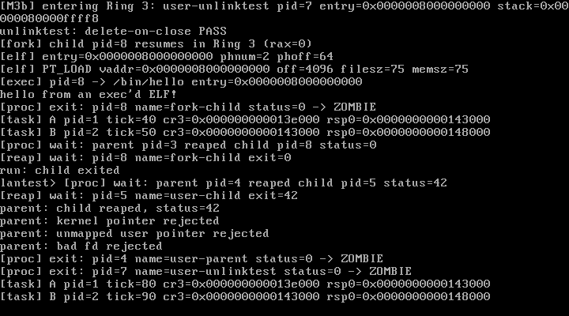

# M4 Step 4 — fork、execve 与 unlink（delete-on-close）

> 状态：**M4-4 已完成并通过实测**（QEMU 串口交互 + VirtualBox 7.2.16）  
> 日期：2026-10-28  
> 关联文档：[M4-shell.md](./M4-shell.md) · [design.md](./design.md)

---

## 1. 本步目标

完成操作系统"深水区"三件套：

1. **fork()**：深拷贝父进程用户地址空间、克隆 fd 表、伪造子进程 iretq 现场；
2. **execve()**：从 ramfs 读取 ELF，重建用户地址空间并跳转，失败时原进程不受影响；
3. **unlink + delete-on-close**：摘除 dentry、`i_nlink--`，最后一个 file close 后才真正释放 inode/数据块；
4. shell 增加 `run <file>`（fork + exec + wait）与 `rm <file>`；
5. 内核安装 `/bin/hello`，shell 启动时自动跑一次 fork/exec 冒烟测试。

---

## 2. 交付物

| 文件 | 作用 |
| --- | --- |
| `arch/x86_64/usermode.S` | 新增 `user_enter_regs()`：用保存的 `registers_t` 返回 Ring 3，供 fork 子进程使用 |
| `arch/x86_64/paging.c` / `include/x86_64/paging.h` | `paging_get_user_page`、`paging_copy_user_space`、`paging_clear_user_root` |
| `include/task.h` / `sched/scheduler.c` | `fork_regs` 字段、`task_fork()` 深拷贝、子进程首次进入、reap 清理 |
| `syscall/syscall.c` | `fork`(9)、`execve`(10)、`unlink`(11) |
| `include/fs.h` / `fs/file.c` | `file_operations.release`、`file_get()`、file 引用计数 |
| `include/vfs.h` / `fs/vfs.c` | `i_open_count`、`vfs_unlink`、`vfs_read_file`、`vfs_write_blob` |
| `fs/ramfs.c` | `ramfs_release`、`ramfs_unlink_inode`（delete-on-close） |
| `user/hello.c` | 被 execve 加载的独立小 ELF |
| `user/unlinktest.c` | delete-on-close 用户态测试 |
| `user/shell.c` | `run` / `rm` 命令；启动时 `run /bin/hello` |
| `kernel.c` | 安装 `/bin/hello`、创建 unlinktest 任务 |
| `Makefile` | hello/unlinktest ELF 嵌入与测试判定 |
| `docs/m4d-vbox.png` | VirtualBox 实测截图 |

---

## 3. fork 实现

### 3.1 地址空间深拷贝

```
new_pml4 = paging_create_kernel_pml4()   /* 复制内核 PML4[0] */
paging_clear_user_root(new_pml4)         /* 关键：清掉从父进程复制来的 PML4[1] */
for each mapped user page in parent:
    new_phys = pmm_alloc_page()
    copy 4 KiB
    paging_map_user(new_pml4, virt, new_phys, USER_PAGE_FLAGS)
```

> **踩坑点**：`paging_create_kernel_pml4()` 原本会复制当前 PML4 的 512 项，包括父进程用户半区。  
> 如果 fork/exec 不清 `PML4[1]`，新地址空间会指向父进程页表，后续映射/释放直接破坏父进程。  
> 因此新增 `paging_clear_user_root()`。

### 3.2 子进程现场

- `task_alloc()` 分配新的 16 KiB 内核栈和首次切换帧；
- 额外 `kmalloc(sizeof(registers_t))` 保存父进程 `int 0x80` 现场，`rax = 0`；
- 子进程第一次被调度时，`task_bootstrap()` 检测到 `fork_regs`：
  - 复制到内核栈局部变量；
  - 释放堆上的 frame；
  - 调用 `user_enter_regs()`，用保存的 RIP/RSP/RFLAGS/CS/SS iretq 回用户态。

`user_enter_regs()` 的字段偏移与 `registers_t` 严格对应（r15..r8、rbp、rdi、rsi、rdx、rcx、rbx、rax、int_no/err_code、rip/cs/rflags/rsp/ss）。

### 3.3 fd 表克隆

```c
for (fd = 0; fd < MAX_FDS; ++fd)
    if (parent->fd_table[fd]) {
        child->fd_table[fd] = parent->fd_table[fd];
        file_get(child->fd_table[fd]);   /* refcount++，不新建 file 对象 */
    }
```

- 父子共享同一个 file（同一 `f_pos`），符合 fork 语义；
- 子进程 exit/exec 时 `task_fd_close_all()` 递减引用计数。

### 3.4 返回值

- 父进程：`regs->rax = child->pid`；
- 子进程：保存帧 `rax = 0`，恢复用户态后 `fork()` 返回 0。

---

## 4. execve 实现

### 4.1 先构建新地址空间，成功后再切换

```
1. copy_from_user 读取路径
2. vfs_read_file(path, image, 64 KiB, &size)   /* 从 ramfs 读 ELF */
3. new_pml4 = paging_create_kernel_pml4()
   paging_clear_user_root(new_pml4)
4. elf_load_user(new_pml4, image, size, &entry)
5. 分配并映射新用户栈页
6. 旧 PML4 保留到这一步，任何失败都销毁 new_pml4 并返回错误
7. 切换：task->cr3 = new_pml4; paging_write_cr3(new_pml4)
8. 释放旧用户地址空间：paging_destroy_user_space(old_cr3)
9. regs->rip = entry; regs->rsp = USER_STACK_TOP - 8; regs->rax = 0
```

- **失败回滚**：路径不存在、ELF 非法、内存不足时当前进程原地址空间完全不受影响；
- 成功时当前进程直接"变成"新程序，fd 表保留（shell 的 stdin/stdout/stderr 仍有效）；
- 暂不支持 argv/envp（`execve` 的 rsi/rdx 被忽略），用户程序无参数启动。

### 4.2 /bin/hello 的安装

内核 `vfs_init()` 之后：

```c
vfs_mkdir("/bin", 0755);
vfs_write_blob("/bin/hello", _binary_user_hello_elf_start, hello_size);
```

- 把嵌入内核的 `user/hello.elf` 写进 ramfs；
- shell 启动时自动 `run /bin/hello`，每次 boot 都验证 fork + exec。

---

## 5. unlink 与 delete-on-close

### 5.1 unlink 只做两件事

```
vfs_lookup(path) -> dentry
从父目录 d_first_child 链表摘除 dentry
inode->i_dentry = NULL
ramfs_unlink_inode(inode):
    i_nlink--
    若 i_nlink == 0 && i_open_count == 0: 释放块链 + inode
```

### 5.2 打开计数

- `struct inode` 新增 `i_open_count`；
- `vfs_open()` 每创建一个 file 对象 `i_open_count++`；
- `file_operations.release` 在 file 引用计数归零时调用：
  - `i_open_count--`；
  - 若 `i_nlink == 0 && i_open_count == 0`，此时才释放 inode/块链。

### 5.3 测试

`user/unlinktest.c`：

1. 创建 `/u.txt`，写 `hello`；
2. 再打开第二个 fd；
3. `unlink("/u.txt")`；
4. 新 open 必须失败；
5. 通过已打开 fd 仍能读到 `hello`；
6. 关闭全部 fd 后，路径依然不存在。

串口结果：

```
[M4] unlinktest task: pid=7
unlinktest: delete-on-close PASS
[proc] exit: pid=7 name=user-unlinktest status=0 -> ZOMBIE
```

---

## 6. shell 扩展与交互实测

新增命令：

```
run <file>   fork + execve + wait
rm <file>    unlink（delete-on-close）
```

启动时自动：

```
Lantest shell (M4-4) - type 'help'
[fork] pid=3 -> child pid=8
[fork] child pid=8 resumes in Ring 3 (rax=0)
[elf] entry=0x8000000000 phnum=2
[elf] PT_LOAD vaddr=0x8000000000 filesz=75 memsz=75
[exec] pid=8 -> /bin/hello entry=0x8000000000
hello from an exec'd ELF!
[proc] exit: pid=8 name=fork-child status=0 -> ZOMBIE
[proc] wait: parent pid=3 reaped child pid=8 status=0
run: child exited
lantest> 
```

真实串口交互：

```
lantest> run /bin/hello
[fork] pid=3 -> child pid=9
[fork] child pid=9 resumes in Ring 3 (rax=0)
[exec] pid=9 -> /bin/hello entry=0x8000000000
hello from an exec'd ELF!
run: child exited
lantest> rm /a.txt
rm: removed /a.txt
lantest> cat /a.txt
cat: cannot open /a.txt
lantest> ls
bin/
hello.txt
big.bin
tmp/
```

检查项全部 PASS（banner、hello、run child exited、rm、cat 失败、help）。

---

## 7. 回归与构建

- QEMU `make test` → **PASS**（A=35、B=35；含 fork/exec 与 delete-on-close 自动化）；
- `make test-exception` → **PASS**；
- **VirtualBox 7.2.16**：串口显示 fork/exec/hello/unlinktest PASS，VGA 截图见下；
- 构建零警告；`kernel.elf` 约 245 KB，ISO 约 5.80 MB。



---

## 8. 踩坑记录

| 问题 | 处理 |
| --- | --- |
| `paging_create_kernel_pml4()` 复制了父进程用户半区 | 新增 `paging_clear_user_root()`，fork/exec 先清 PML4[1] |
| 子进程不能直接改父进程返回帧 | 单独保存 `registers_t` 副本，子进程 `rax=0`；父进程帧写 pid |
| 子进程首次调度不能走 `user_enter(entry,stack)` | 新增 `user_enter_regs()`，按保存帧 iretq |
| exec 失败会毁掉旧进程 | 新 PML4 上先加载，全部成功后才切 CR3/释放旧空间 |
| 共享 file 后 unlink 立即释放 inode → 已打开 fd 悬空 | 增加 `i_open_count` + `release`，delete-on-close |
| 内核测试程序链路 | shell 启动自动 `run /bin/hello`，make test 直接覆盖 fork/exec |
| 测试脚本读串口死循环 | 后台 A/B/tick 日志持续输出，改为固定时间窗口收包 |

---

## 9. 已知限制

1. **没有 argv/envp**：execve 忽略 rsi/rdx，新程序无参数；
2. fork 是**全量深拷贝**，没有 COW；大进程 fork 成本高；
3. 只能 fork 用户任务，内核线程不支持 fork；
4. 没有 `vfork`、没有写时复制、没有进程组/会话/信号；
5. `unlink` 只支持普通文件，不支持目录、硬链接/符号链接；
6. 权限位仍未强制；单 superblock/无 mount；
7. 仍只有 COM1 输入，无键盘 IRQ（可选项）；
8. shell 无管道、后台任务、通配符、环境变量；`run` 不支持参数。

---

## 10. 下一步（M4-5 / M5）

### M4-5：可执行程序体验完善

1. **argv/envp**：execve 把 argc/argv/envp 压到新用户栈；
2. 键盘 IRQ1 + 环形缓冲区，替代 COM1 轮询；
3. fork COW 或至少按需复制；
4. shell 支持 `run /bin/prog arg1 arg2`、管道/重定向组合；
5. 进程信号（Ctrl-C）与简单作业控制。

### M5

virtio-blk + 自研磁盘文件系统，把 ramfs 换成可持久化存储；`/bin/hello` 等文件从磁盘读取。

---

## 11. 复现清单

- [x] fork：用户页深拷贝、新内核栈、fd 引用计数、子进程 rax=0
- [x] execve：ramfs ELF → 新 PML4 → 切 CR3 → 释放旧空间；失败回滚
- [x] `/bin/hello` 安装与 shell 自动 fork/exec
- [x] unlink + `i_open_count` + delete-on-close 用户态测试 PASS
- [x] shell `run` / `rm` 命令
- [x] QEMU 串口真实交互测试 PASS
- [x] `make test` / `make test-exception` PASS
- [x] VirtualBox 7.2.16 实测（串口 + 截图）
- [x] 构建零警告
