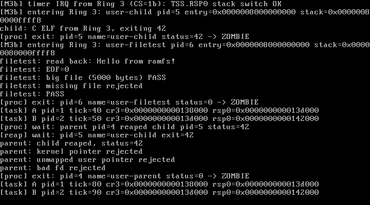

# M4 Step 3 — 串口输入、目录操作与 init/shell

> 状态：**M4-3 已完成并通过实测**（QEMU 10.2.1 交互会话 + VirtualBox 7.2.16）  
> 日期：2026-10-28  
> 关联文档：[M4-vfs-ramfs.md](./M4-vfs-ramfs.md) · [design.md](./design.md)

---

## 1. 本步目标

让系统脱离"内核硬编码测试程序"，变成可交互的独立系统：

1. **COM1 轮询输入** + `console_read`，让 `read(0, buf, n)` 真正能读到一行；
2. **`mkdir`** 系统调用，支持在已有目录下创建子目录；
3. **目录 read**：`struct dirent` + 目录 `f_pos`，让 `ls` 能工作；
4. **O_TRUNC**：打开时清空已有文件，支撑 `echo ... > file`；
5. 用户态 **init/shell**：内置 `help/ls/cat/mkdir/touch/echo/exit`；
6. 用 QEMU 串口 socket 注入真实键盘输入，验证完整交互链路。

---

## 2. 交付物

| 文件 | 作用 |
| --- | --- |
| `include/uart.h` / `drivers/uart.c` | `uart_poll_getc()`、`uart_available()`（LSR.DR 轮询） |
| `drivers/console.c` | `console_read`：按行读取、回显、退格、`sti; hlt` 等待 |
| `include/vfs.h` | `struct dirent`、`DT_REG/DT_DIR`、`i_dentry`、`vfs_mkdir()` |
| `fs/ramfs.c` | `ramfs_mkdir`、`ramfs_dir_read`、`ramfs_truncate` |
| `fs/vfs.c` | `vfs_mkdir`、O_TRUNC 处理 |
| `include/fs.h` | `O_TRUNC` |
| `include/syscall.h` / `syscall/syscall.c` | 新增 `mkdir`(8) |
| `user/userlib.h` | `sys_mkdir`、`struct dirent`、`O_TRUNC` |
| `user/shell.c` | 内置命令 shell（init 进程） |
| `kernel.c` | 创建 shell 用户任务（pid=3） |
| `Makefile` | shell ELF 嵌入、`Lantest shell` 测试判定 |
| `docs/m4c-vbox.png` | VirtualBox 实测截图 |

---

## 3. 串口输入与 console_read

### 3.1 UART 轮询

```c
int uart_poll_getc(char *out)
{
    if (!uart_present) return 0;
    if ((inb(COM1 + LSR) & LSR_DR) == 0) return 0;
    *out = inb(COM1);
    return 1;
}
```

- UART 中断保持关闭（初始化时 `outb(COM1+1, 0x00)`），输入靠轮询；
- `console_read` 在没数据时执行 `sti; hlt`：
  - PIT 100 Hz 每 10 ms 唤醒一次，避免纯忙等；
  - 唤醒后调度器仍可运行 A/B 线程、回收器等；
  - `sti` 在 syscall 上下文中重新开中断，shell 阻塞时系统不假死。

### 3.2 行缓冲与回显

```
读取字符 -> 可打印：存入 buf 并回显
          -> 退格 0x7F/0x08：删除一个字符，输出 "\b \b"
          -> '\r' / '\n'：补 '\n'，返回整行长度
          -> 其它控制字符：忽略
```

- `read(0, ...)` 返回**一行**（含 `\n`），shell 直接按行解析；
- 无 UART 设备时返回 `-EINVAL`，shell 打印错误并退出，不会挂死。

---

## 4. mkdir 与目录读取

### 4.1 mkdir

```
sys_mkdir(path, mode)
  -> 路径必须是绝对路径
  -> vfs_lookup(path) 已存在 => -EEXIST
  -> split_path 得到父路径 + 名字
  -> 解析父 dentry，必须是目录
  -> ramfs_mkdir：新 inode（S_IFDIR|0755）+ 新 dentry，挂到父目录链表
```

### 4.2 目录 read

```c
struct dirent {
    u64 d_ino;
    u32 d_type;     /* DT_REG / DT_DIR */
    u32 d_pad;
    char d_name[64];
};
```

- inode 增加 `i_dentry` 回指针，目录 read 通过它找到子项链表；
- `file->f_pos` 表示"下一个子项索引"，每次 read 返回一个 dirent（80 字节）；
- 没有更多子项时返回 **0**；
- `ls` 循环 `read(fd, &de, sizeof(de))`，按 `d_type` 给目录名补 `/`。

### 4.3 O_TRUNC

- `open(path, O_TRUNC)` 对已存在的普通文件调用 `ramfs_truncate()`：
  - 遍历块链 `kfree` 全部块；
  - `i_size = 0`，`i_data = NULL`。
- 支持 shell 的 `echo xxx > file` 覆盖写语义。

---

## 5. init / shell

`user/shell.c` 编译成第四块 ELF，由内核 `task_create_user_elf("user-init", ...)` 创建（pid=3）：

```
Lantest shell (M4-3) - type 'help'
lantest> 
```

内置命令（**暂不 fork/exec**，全部用 syscall 在当前进程实现）：

| 命令 | 实现 |
| --- | --- |
| `help` | 打印帮助 |
| `ls [path]` | open 目录 + read dirent + 打印名字 |
| `cat <file>` | open + read + write(stdout) |
| `mkdir <path>` | sys_mkdir |
| `touch <file>` | open(O_CREAT|O_RDWR) + close |
| `echo <text> [> file]` | 打印；带 `>` 时 open(O_CREAT|O_TRUNC) 写入 |
| `exit` | sys_exit(0) |

行缓冲 128 字节；`>` 重定向解析、首尾空白裁剪都在用户态完成。

---

## 6. 交互实测（QEMU 串口 socket）

QEMU 以 TCP socket 暴露 COM1，Python 连接后注入真实按键：

```
qemu-system-x86_64 ... -chardev socket,id=ser,host=127.0.0.1,port=4569,server=on,wait=off -serial chardev:ser
```

发送与回读：

```
lantest> help
commands:
  help                 this help
  ls [path]            list directory (default /)
  cat <file>           print file contents
  mkdir <path>         create directory
  touch <file>         create empty file
  echo <text> [> file] print text or write it to a file
  exit                 leave the shell
lantest> ls
hello.txt
big.bin
lantest> mkdir /tmp
mkdir: ok
lantest> ls
hello.txt
big.bin
tmp/
lantest> echo hello > /a.txt
echo: wrote /a.txt
lantest> cat /a.txt
hello
lantest> touch /b.txt
lantest> ls
hello.txt
big.bin
tmp/
a.txt
b.txt
lantest> exit
[proc] exit: pid=3 name=user-init status=0 -> ZOMBIE
```

检查项全部 PASS：

- `Lantest shell (M4-3)` / `commands:`
- `mkdir: ok`
- `echo: wrote /a.txt`
- `cat` 输出 `hello`
- `ls` 能看到 `tmp/`、`a.txt`、`b.txt`
- `exit` 正常退出，shell 变成 ZOMBIE

---

## 7. 回归与构建

- QEMU `make test` → **PASS**（A=35、B=35；shell 阻塞在输入，其余测试照常跑完）；
- `make test-exception` → **PASS**；
- **VirtualBox 7.2.16**：COM1 日志显示 shell banner/prompt，VGA 截图见下；
- 构建零警告；`kernel.elf` 约 220 KB，ISO 约 5.76 MB。



---

## 8. 踩坑记录

| 问题 | 处理 |
| --- | --- |
| shell 没有 `NULL` 定义 | 用户态 `-nostdinc`，改用 `0` 表示空指针 |
| 串口无中断，`hlt` 会不会睡死 | UART IRQ 关闭，但 PIT 100 Hz 会唤醒；每次唤醒轮询 LSR |
| shell 阻塞导致其他任务饿死 | `sti; hlt` 让 PIT 抢占，A/B/回收器继续运行 |
| 目录 read 没有子项来源 | inode 增加 `i_dentry` 回指针，目录 read 遍历 dentry 链表 |
| 目录 read 与文件 read 混用 | `ramfs_read` 先判断 `S_IFDIR`，分派到 `ramfs_dir_read` |
| `ls` 读多少字节 | 每次 read 一个 `struct dirent`（80 字节）；EOF 返回 0 |
| `echo > file` 覆盖旧内容 | 新增 O_TRUNC + `ramfs_truncate` 释放块链 |
| QEMU 串口测试读取死循环 | 后台每秒都有 A/B/tick 日志，不能靠"recv 超时"判断命令结束；改为固定时间窗口收包 |

---

## 9. 已知限制

1. **没有 fork/exec**：shell 命令是内置的，不能执行任意 ELF；
2. **没有 unlink**：文件/目录删除、delete-on-close 语义未实现；
3. 没有键盘 IRQ 驱动，只支持 COM1 输入；
4. shell 无 `cd`、无管道、无后台任务、无环境变量/argv；
5. 输入行最长 127 字节，超长截断；
6. 目录只能逐项读取，没有 `getdents` 批量/偏移优化；
7. inode/dentry 仍不回收，ramfs 单层路径树，无 mount；
8. 权限位不强制。

---

## 10. 下一步（M4-4 / M5）

### M4-4：可执行文件与删除语义

1. **fork/exec**：从当前进程复制地址空间/任务，再加载新 ELF（复用 `elf_load_user`）；
2. `unlink` + delete-on-close：父目录摘除 dentry，`i_nlink=0` 时等最后一个 file close 再释放 inode/块；
3. 键盘 IRQ1 + 环形缓冲区，替代纯串口轮询；
4. shell 支持执行 `/bin/*`（需要更多 ELF 程序与简单 argv）。

### M5

virtio-blk + 自研磁盘文件系统，把 ramfs 换成可持久化存储。

---

## 11. 复现清单

- [x] COM1 轮询输入 + 行缓冲/回显/退格
- [x] `read(0,...)` 阻塞读一行，PIT 唤醒不忙等
- [x] `mkdir` 系统调用 + 路径解析嵌套目录
- [x] `struct dirent` 目录 read，`ls` 可用
- [x] O_TRUNC + `ramfs_truncate`
- [x] init/shell：help/ls/cat/mkdir/touch/echo/exit
- [x] QEMU 串口 socket 真实交互测试通过
- [x] `make test` / `make test-exception` PASS
- [x] VirtualBox 7.2.16 实测（串口 + 截图）
- [x] 构建零警告
