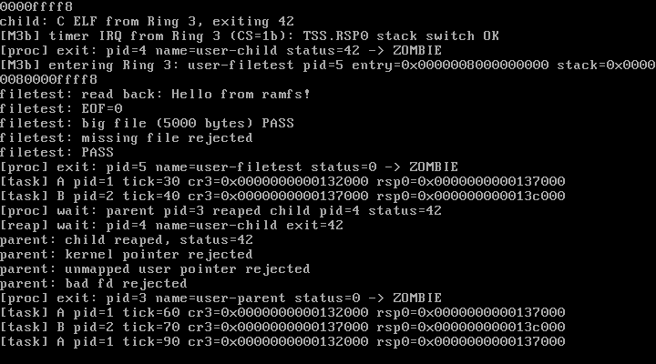

# M4 Step 2 — VFS 核心（superblock / inode / dentry）与 ramfs

> 状态：**M4-2 已完成并通过实测**（QEMU 10.2.1 + VirtualBox 7.2.16）  
> 日期：2026-10-28  
> 关联文档：[M4-fd-console.md](./M4-fd-console.md) · [design.md](./design.md)

---

## 1. 本步目标

在 M4-1 的 fd 层之上补上真正的文件系统抽象：

1. 自研 **superblock / inode / dentry** 骨架；
2. **绝对路径解析**（先只支持正向查找，不处理相对路径）；
3. **ramfs**：4 KiB 块链作为文件数据；
4. 系统调用 **open / read / close**，与已有 `write(fd,...)` 组成完整文件 I/O；
5. 用户态 C 程序真实创建文件、写入、跨块读回、验证 EOF、拒绝缺失路径；
6. 保持 fd 生命周期、uaccess/SMAP、进程回收无回归。

---

## 2. 交付物

| 文件 | 作用 |
| --- | --- |
| `include/vfs.h` | `superblock` / `inode` / `dentry`、`vfs_lookup()`、`vfs_open()` |
| `fs/vfs.c` | 路径解析、父目录/文件名拆分、`O_CREAT` 打开流程 |
| `include/ramfs.h` / `fs/ramfs.c` | ramfs 根目录、inode/dentry 创建、4 KiB 块链读写 |
| `include/errno.h` | 增加 `ENOENT` / `ENOMEM` / `EISDIR` / `EMFILE` |
| `include/syscall.h` / `syscall/syscall.c` | 新增 `open`(5)、`read`(6)、`close`(7) |
| `include/fs.h` | 增加 `O_CREAT` |
| `user/userlib.h` | `sys_open` / `sys_read` / `sys_close` 与 `O_*` 标志 |
| `user/filetest.c` | Ring 3 文件 I/O 测试程序（第三块 ELF） |
| `kernel.c` | `vfs_init()`、创建 filetest 用户任务 |
| `Makefile` | 新源文件、filetest 嵌入、M4-2 测试判定 |
| `docs/m4b-vbox.png` | VirtualBox 实测截图 |

---

## 3. 核心结构（全部自研）

```c
struct inode {
    u64 i_ino;
    u32 i_mode;                 /* S_IFDIR / S_IFREG + 权限位 */
    u64 i_size;
    u32 i_nlink;
    void *i_data;               /* ramfs: 4 KiB 块链 */
    struct superblock *i_sb;
    const struct file_operations *i_fop;
};

struct dentry {
    char d_name[VFS_NAME_MAX];
    struct inode *d_inode;
    struct dentry *d_parent;
    struct dentry *d_first_child;
    struct dentry *d_next_sibling;
};

struct superblock {
    struct dentry *s_root;
    u64 s_inode_count;
};
```

- 目录的子项用 dentry 单链表维护，够小、够直观；
- inode 持有默认 `file_operations`，打开时复制到新 file 对象；
- 结构布局、字段名、语义都是 Lantest OS 自己的，不复制 Linux。

---

## 4. 路径解析

`vfs_lookup("/hello.txt")`：

1. 必须以 `/` 开头（当前只支持绝对路径）；
2. 跳过连续 `/`；
3. 取一个分量到 `name[64]`；
4. 当前 dentry 必须是目录；
5. 在 `d_first_child` 链表中做字符串精确匹配；
6. 命中则下钻，未命中返回 NULL。

`O_CREAT` 时 `split_path()` 取最后一个 `/`：

- 父路径：`/` 或 `/a` 等；
- 文件名：最后一段；
- 解析父目录 dentry → `ramfs_create_file(parent, name)` 创建 inode + dentry；
- 挂到父目录子链表，然后分配 `struct file` 返回。

---

## 5. ramfs

### 5.1 数据块

```c
struct ramfs_block {
    struct ramfs_block *next;
    u8 data[4096];
};
```

- 按需 `kmalloc`，新块清零；
- `i_data` 指向块链头；
- `i_size` 记录文件长度。

### 5.2 read

```
pos = file->f_pos
if (pos >= inode->i_size) return 0        // EOF，必须是 0，不能是 -1
n = min(count, size - pos)
按块拷贝 n 字节
file->f_pos += n
return n
```

### 5.3 write

```
pos = file->f_pos
end = pos + count
若 pos > size：先把 [size, pos) 补零
按块写入，块不存在则分配
size = max(size, end)
file->f_pos = end
return count
```

`f_pos` 完全由 file 对象维护；**syscall 层不再二次累加**（M4-2 修复的一个细节）。

### 5.4 目录

- 根目录 `/` 是静态 inode/dentry；
- 目前只能通过 `O_CREAT` 在已存在的目录里创建普通文件；
- `mkdir`、目录 read/unlink 还没实现（M4-3）。

---

## 6. 系统调用

| 调用 | 号 | 参数 | 返回 |
| --- | --- | --- | --- |
| `open` | 5 | `rdi=path`, `rsi=flags` | fd 或 `-ENOENT` / `-EFAULT` / `-EMFILE` |
| `read` | 6 | `rdi=fd`, `rsi=buf`, `rdx=len` | 字节数；EOF 返回 **0**；错误为负 |
| `close` | 7 | `rdi=fd` | 0 或 `-EBADF` |

- `open` 的路径按**逐字节 copy_from_user** 拷入内核，越界页由 fixup 返回 `-EFAULT`；
- 每次 open 创建**独立 file 对象**，`f_pos` 互不影响；
- `read` 分块（256 B）从 `f_op->read` 拿到内核缓冲，再 `copy_to_user`；
- `close` 走已有 `task_fd_close()`，引用计数归零才释放 file；inode/dentry 留在 ramfs 中。

---

## 7. 用户态测试（第三块 ELF：filetest）

```c
fd = sys_open("/hello.txt", O_CREAT | O_RDWR);
sys_write(fd, "Hello from ramfs!\n", 18);
sys_close(fd);

fd = sys_open("/hello.txt", O_RDONLY);
n = sys_read(fd, buf, 63);        // 18
n = sys_read(fd, buf, 63);        // 0 = EOF
sys_close(fd);

/* 5000 字节 = 跨两个 4 KiB ramfs 块 */
sys_write("/big.bin", pattern, 5000);
sys_read("/big.bin", ...);         // 逐字节校验

sys_open("/no-such-file", O_RDONLY);  // -ENOENT
```

实际串口输出：

```
[M4] VFS: superblock + root inode/dentry ready (ramfs)
[M4] VFS: root mount "/" inode=1
[M4] filetest task: pid=5
filetest: read back: Hello from ramfs!
filetest: EOF=0
filetest: big file (5000 bytes) PASS
filetest: missing file rejected
filetest: PASS
[reap] orphan: pid=5 name=user-filetest exit=0
```

- 5000 字节测试同时覆盖 ramfs 块链和 ELF `.bss` 清零（filetest 的 `.bss` 约 10 KB，跨 3 个用户页）；
- filetest 退出后由 orphan reaper 正常回收。

---

## 8. 实测记录

### QEMU `-cpu max`

`make test` → **PASS**：

- VFS/ramfs 初始化；
- `open(O_CREAT)` → `write` → `close` → `open` → `read` → EOF → `close`；
- 5000 字节跨块读写校验通过；
- 缺失路径返回 `-ENOENT`；
- fd 表、uaccess/SMAP、ELF、Ring 3、生命周期全部无回归（A=47/B=46）。

### 异常回归

`make test-exception` → **PASS**。

### VirtualBox 7.2.16

同一 ISO 完整跑通文件测试；串口与截图一致。



---

## 9. 踩坑记录

| 问题 | 现象 | 解决 |
| --- | --- | --- |
| 空 PT_LOAD 段 | `filetest.elf` 没有 `.data/.bss` 时链接器生成 `vaddr=0, memsz=0` 的 LOAD 段，ELF 加载器按普通段校验 `vaddr < USER_BASE` 直接判非法 | 零长度 PT_LOAD 在校验地址前直接忽略；日志也不再打印 |
| `f_pos` 双重累加 | syscall write 和 ramfs_write 都更新 f_pos，连续写会跳偏移 | 约定由 `file_operations` 维护 f_pos，syscall 只负责拷贝 |
| 路径名未终止 | `split_path()` 拷贝最后一段后没有写 `'\0'`，dentry 名字带垃圾 | 循环后显式 `name[n] = '\0'` |
| 用户路径跨页 | 直接按 256 字节 copy 可能读越界 | 逐字节 `copy_from_user`，未映射页由 fixup 安全返回 `-EFAULT` |
| EOF 返回值 | 读完后返回 -1 会让 `cat` 类程序死循环 | ramfs read 在 `pos >= size` 时返回 **0** |
| 文件消失 | close 释放 file 时误释放 inode | inode/dentry 归 ramfs，只有 file 对象按引用计数释放 |

---

## 10. 已知限制

1. 只支持**绝对路径**，没有相对路径、`.`/`..`；
2. 只有根目录，`mkdir`/目录遍历/unlink/truncate 未实现；
3. 没有目录 read（`ls` 需要 `struct dirent` 与目录迭代）；
4. inode/dentry 没有引用计数与回收，ramfs 数据在卸载前一直常驻；
5. 块链按索引线性遍历，文件很大时性能一般；
6. 没有 page cache、mmap、权限检查（i_mode 只记录）；
7. 没有 mount/unmount，单 superblock；
8. `O_RDONLY/O_WRONLY` 只记录，未强制读写权限；
9. fd 表固定 32 项。

---

## 11. 下一步（M4-3）

1. `mkdir(path, mode)` + 目录迭代 read（`struct dirent { ino, type, name }`）；
2. `unlink` / `truncate` / `O_TRUNC`；
3. 用户态 `init`：创建 `/tmp`、`/dev`；
4. 简易 shell：`ls`、`cat`、`echo > file`；
5. 把 parent/child/filetest 变成 shell 命令或启动脚本。

之后进入 M5：virtio-blk + 自研磁盘文件系统。

---

## 12. 复现清单

- [x] `superblock` / `inode` / `dentry` 自研骨架
- [x] 绝对路径解析 + `O_CREAT` 创建文件
- [x] ramfs 4 KiB 块链 read/write，`f_pos` 正确
- [x] `open`(5) / `read`(6) / `close`(7) 系统调用
- [x] 18 字节小文件 + 5000 字节跨块文件读写校验
- [x] EOF 返回 0；缺失路径返回 `-ENOENT`
- [x] fd 生命周期、uaccess、ELF、Ring 3 无回归
- [x] QEMU `make test` / `make test-exception` PASS
- [x] VirtualBox 7.2.16 实测（串口 + 截图）
- [x] 构建零警告
