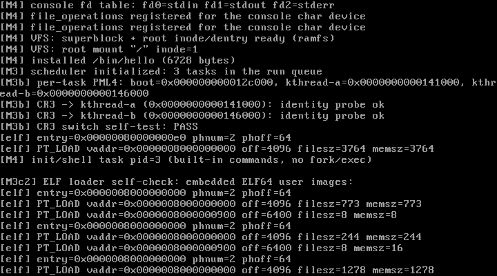

# M5 Step 1 — PCI 枚举与 virtio-blk 块设备

> 状态：**M5-1 已完成并通过实测**（QEMU 10.2.1 + virtio-blk-pci，真实 16 MiB 磁盘镜像）  
> 日期：2026-10-28  
> 关联文档：[design.md](./design.md) · [M4-fork-exec-unlink.md](./M4-fork-exec-unlink.md)

---

## 1. 本步目标

让兰特斯特第一次拥有 **持久化块设备**：

1. 用 0xCF8/0xCFC 做 **PCI 总线枚举**，找到 virtio-blk（vendor `0x1AF4` / device `0x1001`）；
2. 完成 **legacy virtio-pci 状态机握手**；
3. 建立 **virtqueue**：描述符表 + Available Ring + Used Ring，全部用物理地址交给设备做 DMA；
4. 封装 `virtio_blk_read(sector, buf, count)` / `virtio_blk_write(...)`；
5. 启动自检：读写磁盘最后一个 sector，验证 **跨重启持久化**（`boot_count` 递增）；
6. QEMU 提供 `disk.img`，VirtualBox 无 virtio 时优雅降级（RAM-only）。

---

## 2. 交付物

| 文件 | 作用 |
| --- | --- |
| `include/pci.h` / `drivers/pci.c` | legacy PCI 配置空间读写、vendor/device 扫描 |
| `include/virtio_blk.h` / `drivers/virtio_blk.c` | legacy virtio-blk 初始化、virtqueue、扇区读写、自检 |
| `include/io.h` | 新增 `inl/outl` |
| `kernel.c` | 启动时探测 virtio-blk 并执行自检 |
| `Makefile` | `disk.img`、QEMU `-drive/-device virtio-blk-pci`、`test-persist` 目标 |
| `docs/m5a-qemu.png` | QEMU 启动实测截图 |
| `.gitignore` | 忽略 `disk.img` |

---

## 3. PCI 枚举

```c
u32 id = pci_read32(bus, dev, func, 0);
if ((id & 0xFFFF) == 0x1AF4 && (id >> 16) == 0x1001)
    /* virtio-blk legacy */
```

- 地址：`0x80000000 | bus<<16 | dev<<11 | func<<8 | off` 写入 `0xCF8`，数据端口 `0xCFC`；
- 全总线扫描；找到后读 BAR0；
- BAR0 bit0 = 1 表示 I/O 空间，基址 `bar0 & ~3`；
- PCI command 置位 **I/O enable + bus master**（允许设备 DMA）：
  ```c
  command |= 0x5;   /* bit0 I/O space, bit2 bus master */
  ```

QEMU 输出：

```
[virtio] virtio-blk ready: I/O=c000 qsize=256 capacity=32768 sectors
```

---

## 4. legacy virtio 握手

```
status = 0                    // reset
status |= ACKNOWLEDGE
status |= DRIVER
read host features
guest features = 0
status |= FEATURES_OK
检查 status.FEATURES_OK
queue_select = 0
qsize = inw(io + 0x0C)
queue_addr = vq_phys >> 12    // 注意：QueuePFN！
status |= DRIVER_OK
```

**踩到的致命坑：**

> 老式 virtio-pci 的 0x08 寄存器叫 **QueuePFN**，保存的是"物理页帧号"（`phys >> 12`），不是物理地址。  
> 第一次写成完整 `vq_phys`，设备把队列地址解释成 `value << 12`，DMA 到完全错误的内存，结果 `[virtio] I/O timeout`。  
> 改成 `vq_phys >> 12` 后立刻通过。新版 virtio 1.0 的现代 MMIO 接口才使用完整 64 位地址，两者不能混。

---

## 5. virtqueue 与 DMA

一块连续 3 页（12 KiB）内核物理内存（identity map，所以虚拟地址即物理地址）：

```
offset 0:                  descriptor table   16 * qsize bytes
offset 16*qsize:           available ring    flags/idx/ring[]
ALIGN(..., 4096):          used ring           flags/idx/ring[]
```

每个请求是 3 个描述符的链：

| 描述符 | 内容 | flags |
| --- | --- | --- |
| 0 | `virtio_blk_req { type, reserved, sector }` | NEXT |
| 1 | 数据缓冲区（512 B × n） | NEXT + (读请求: WRITE) |
| 2 | 1 字节状态 | WRITE |

提交：

```c
avail->ring[avail->idx % qsize] = 0;
__sync_synchronize();
avail->idx++;
__sync_synchronize();
outw(io_base + 0x10, 0);       // queue notify
```

轮询 used ring：

```c
while (*used_idx == last_used)
    pause;
id = used_ring[last_used % qsize].id;
last_used++;
status == 0 ? success : error;
```

- 读请求：设备写数据缓冲区 → 数据描述符必须 `WRITE`；
- 写请求：设备读数据缓冲区 → 不带 `WRITE`；
- 状态字节由设备写，最后检查 0 表示成功；
- 目前单队列、单请求、纯轮询，不使用中断。

---

## 6. 自检与持久化

`最后一个 sector` 布局（M5-2 起从 sector 0 移到这里，避免与 LantestFS 超级块冲突）：

```
offset 0..7  : "LNTSTBLK"
offset 8..11 : boot_count (little endian u32)
```

每次启动：

1. 读最后一个 sector；
2. magic 匹配则 `boot_count++`，否则初始化 `boot_count=1`；
3. 写回；
4. 再读并校验；
5. 打印 `[virtio] self-test: PASS (disk boot_count=N)`。

串口证据：

```
# 第一次启动
[virtio] virtio-blk ready: I/O=c000 qsize=256 capacity=32768 sectors
[virtio] self-test: PASS (disk boot_count=1)

# 同一 disk.img 第二次启动
[virtio] virtio-blk ready: I/O=c000 qsize=256 capacity=32768 sectors
[virtio] self-test: PASS (disk boot_count=2)
```

`make test-persist` 自动完成两次启动并断言 `1 -> 2`：

```
M5-1 persistence test: PASS (boot_count 1 -> 2)
```

---

## 7. 构建与测试集成

Makefile：

```make
QEMU_DISK := -drive file=disk.img,if=none,id=disk,format=raw \
             -device virtio-blk-pci,drive=disk
```

- `disk.img` 是 16 MiB raw 稀疏文件，首次 make 时 `truncate -s 16M`；
- `make test` 启动 QEMU 并检查 `virtio-blk ready` + `self-test: PASS`；
- `make test-persist` 重建磁盘、连续启动两次，检查 boot_count；
- VirtualBox 没有 virtio-blk（当前配置），内核打印：
  ```
  [virtio] no virtio-blk PCI device
  [M5] virtio-blk unavailable; RAM-only mode
  ```
  其余功能继续正常运行。

---

## 8. 实测记录

- QEMU `make test` → **PASS**（含 virtio 自检、VFS/ramfs、uaccess、ELF、fork/exec、生命周期）；
- `make test-persist` → **PASS**（boot_count 1 → 2）；
- `make test-exception` → **PASS**；
- 构建零警告；`kernel.elf` 286,144 字节，ISO 5,812,224 字节；
- 磁盘容量 32768 sectors = 16 MiB。



> 截图是 QEMU VGA 的启动后段；virtio 的完整日志见上面的串口节选。

---

## 9. 踩坑记录

| 问题 | 处理 |
| --- | --- |
| QueuePFN 写成物理地址 | legacy 需要 `phys >> 12`；修复后 I/O 通过 |
| PCI BAR 不可用 | 检查 BAR0 bit0=I/O；否则放弃 |
| DMA 被禁止 | PCI command 必须置 bus master（0x4） |
| 读请求数据方向 | 数据描述符加 `WRITE`；写请求不加 |
| 队列内存不连续 | `pmm_alloc_pages(3)` 保证物理连续 |
| 设备没有中断 | 轮询 used ring；带超时避免死等 |
| VirtualBox 无 virtio | 优雅降级 RAM-only，不 panic |

---

## 10. 已知限制

1. 只支持 **legacy virtio-pci**（device 0x1001）；现代 virtio 1.0 MMIO 未实现；
2. 单队列、单请求、纯轮询，无中断/MSI-X；
3. 固定 512 字节扇区，无块缓存、无合并 I/O；
4. 磁盘仍是裸扇区，**还没有文件系统**；
5. 没有多设备/热插拔；
6. 无 SMP 锁；目前单核安全。

---

## 11. 下一步（M5-2）

### LantestFS：自研持久化文件系统

计划把 `virtio_blk_read/write` 接到 VFS：

1. **超级块**：sector 0 保存 magic、块大小、inode 数量、空闲块位图位置；
2. **inode 表**：固定区域，记录类型/大小/直接块指针；
3. **块位图**：分配/释放 4 KiB 数据块；
4. **目录**：目录文件内容为 `{name, inode}` 项；
5. **挂载**：`/` 从 ramfs 换成 LantestFS 根；
6. 持久化 `open/read/write/close/mkdir/unlink`，重启后文件仍在。

之后回到 **M4-5**：argv/envp、键盘 IRQ、COW。

---

## 12. 复现清单

- [x] PCI 0xCF8/0xCFC 枚举，找到 virtio-blk
- [x] legacy 状态机握手 + bus master DMA
- [x] virtqueue 布局与 3 描述符请求链
- [x] 扇区读/写 API
- [x] 最后一个 sector 自检（magic + boot_count）
- [x] `make test` / `make test-persist` / `make test-exception` PASS
- [x] QEMU 实测（16 MiB raw disk）
- [x] VirtualBox 无 virtio 时优雅降级
- [x] 构建零警告
